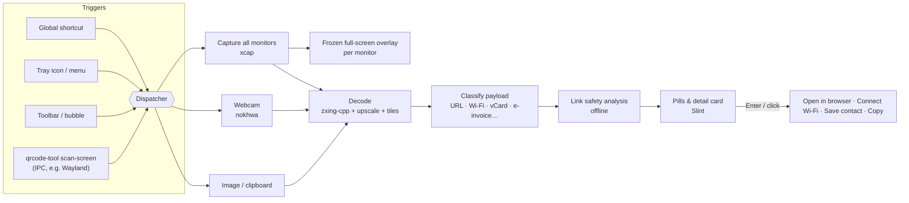

# QRcode tool


 · **English** · [繁體中文](docs/i18n/README.zh-TW.md) · [简体中文](docs/i18n/README.zh-CN.md) · [Español](docs/i18n/README.es.md) · [Português (Brasil)](docs/i18n/README.pt-BR.md) · [日本語](docs/i18n/README.ja.md) · [한국어](docs/i18n/README.ko.md) · [Français](docs/i18n/README.fr.md) · [Deutsch](docs/i18n/README.de.md) · [Русский](docs/i18n/README.ru.md) · 

Press a shortcut → every QR code on your screen gets a label → press Enter.  

Works with your webcam too. Free, open source and private.

📘 **User manual:** [PDF](docs/manual/QRcode-tool-User-Manual-en.pdf) · [.docx](docs/manual/QRcode-tool-User-Manual-en.docx) — also attached to every [release](https://github.com/naritaroad/qrcode-tool/releases/latest). Other languages are in [docs/manual](docs/manual/README.md).


---


## Features


|                                |                                                                                                                                                                                     |
| ------------------------------ | ----------------------------------------------------------------------------------------------------------------------------------------------------------------------------------- |
| ⚡ **Easy to use**              | Press Ctrl+Alt+Q, or click the tray icon, to freeze the screen. A quick scan sweep finds every code automatically.                                                                  |
| 🏷️ **Link labels**            | Each code shows the real site name. Enter opens it, Tab moves to the next one, C copies.                                                                                            |
| ✂️ **Select an area**          | When a code is tiny, blurry or tilted, drag a box around it like a snipping tool.                                                                                                   |
| 📷 **Webcam**                  | Hold a printed code or a phone screen up to the camera; results appear live.                                                                                                        |
| 🛡️ **Link safety**            | Never opens a link by surprise. Warns about look-alike letters, disguised addresses (`bank.com@evil.io`), raw IP addresses, unencrypted `http`, short links and more — all offline. |
| 📶 **Understands the content** | Wi-Fi (connect with one click), contacts (save as vCard), email, phone, SMS, map locations, 2-step verification keys, Taiwan e-invoices (both codes merged) and plain text.         |
| 🧾 **Barcodes**                | EAN, UPC, Code 128, Data Matrix, PDF417, Aztec…                                                                                                                                     |
| 🖼️ **Images & clipboard**     | Scan a screenshot you copied or any image file.                                                                                                                                     |
| 🔳 **Simple QR generator**     | Turn a link or text into a QR code; copy it or save PNG/SVG.                                                                                                                        |
| 🧰 **Toolbar & bubble**        | A clean floating toolbar — a row at the top or a column at the right or left edge — that collapses into a bubble and hides automatically during full-screen apps.                  |
| 🎨 **Native look**             | Windows style, follows light/dark mode and your accent colour.                                                                                                                      |
| 🌍 **10 languages**            | English, 繁體中文, 简体中文, Español, Português (Brasil), 日本語, 한국어, Français, Deutsch, Русский.                                                                                             |
| 🔒 **Private**                 | Everything runs on your computer. No account, no telemetry, no online link checks. History is off by default.                                                                       |
| ☁️ **Light and fast**          | A native Rust core, with faster performance and lower memory use.                                                                                                                   |


## Demo


|                                                                                                                            |                                                                                                                                |
| -------------------------------------------------------------------------------------------------------------------------- | ------------------------------------------------------------------------------------------------------------------------------ |
|  Suspicious links show why — and wait for you. |  Wi-Fi codes connect with one click; the password stays hidden. |
|  Scan the clipboard or an image file.                  |  Create a QR code.                                  |
|  Windows 11-style settings.                                                           |  Follows dark mode and your accent colour.                                      |


## Architecture




The app is a Cargo workspace: a thin UI crate on top of small, testable libraries.
See **[docs/ARCHITECTURE.md](docs/ARCHITECTURE.md)** for threads, data flow and design decisions.

**Technical details** (click to expand)

#### Decoding strategy

- [zxing-cpp](https://github.com/zxing-cpp/zxing-cpp) reads the frozen screenshot of each monitor in parallel.
- Small screens are also read at 2× scale; large screens are additionally split into overlapping 900 px tiles, so a small code on a 4K monitor is still found.
- Region selection adds a quiet zone and upscales the crop 2–3×.
- The webcam decodes the newest frame on its own thread and a code has to be seen in three consecutive frames before it counts.


#### DPI and multiple monitors

- The screen is captured first and every overlay shows that frozen picture. All coordinates stay in screenshot pixels and are scaled inside the UI, so mixed-DPI setups work without conversion bugs.


#### Link safety rules

- Only `http`/`https` links can be opened; any other scheme is shown and can only be copied.
- Nothing is passed to a shell. Links open with the system browser API.
- Warnings: unencrypted `http`, user-info disguise (`a.com@b.com`), international domains (shows the punycode), mixed alphabets in one label, IP addresses, unusual ports, short links, very long or heavily encoded URLs, deep subdomain chains.
- Links are never opened automatically unless they are the *only* code found, have *no* warnings, and the site is on your *trusted list*.
- Short links are **not** expanded online (that would tell the shortener what you scanned).


#### Platform notes


|                          | Windows 10 21H2+ / 11 | macOS 13+                       | Linux X11         | Linux Wayland                                       |
| ------------------------ | --------------------- | ------------------------------- | ----------------- | --------------------------------------------------- |
| Screen scan              | ✅                     | ✅ (Screen Recording permission) | ✅                 | ⚠️ via portal / compositor                          |
| Global shortcut          | ✅                     | ✅                               | ✅                 | ➖ bind `qrcode-tool scan-screen` in system settings |
| Hide in full-screen apps | ✅                     | ➖                               | ➖                 | ➖                                                   |
| Updates                  | in-app (Velopack)     | in-app                          | in-app (AppImage) | in-app (AppImage)                                   |


#### Sensitive data

- 2-step verification secrets and Wi-Fi passwords are never written to history and never copied automatically.
- Logs contain events and errors only, never scanned content.


## Installation


### Windows 10 (21H2+) / 11 — x64 and ARM64

1. Download `QRcodeTool-win-x64-Setup.exe` (or `…-arm64-…`) from the [latest release](https://github.com/naritaroad/qrcode-tool/releases/latest).
2. Run it. QRcode tool installs for your user only (no admin rights) and starts in the tray.
3. Press Ctrl+Alt+Q to scan (change it in *Settings › Shortcuts* if another app already uses it). Right-click the desktop or a picture for the same tools (*Settings › General › Right-click menu*). On Windows 11, open **Show more options**.

> **"Windows protected your PC"?** Early releases are not code-signed yet, so SmartScreen may warn about an unknown publisher. Click **More info → Run anyway**. You can verify the download with the SHA-256 checksums published with every release. See the [FAQ](docs/FAQ.md#windows-smartscreen).

A **portable** `.zip` is available too (no installer, no automatic updates). The release also contains the user manual as PDF and Word, in English and Traditional Chinese.

### macOS 13+ (Apple silicon and Intel)

Download the `.pkg` from the [latest release](https://github.com/naritaroad/qrcode-tool/releases/latest). On first scan, allow **Screen Recording** (and **Camera** for webcam scanning) in *System Settings › Privacy & Security*. Releases are not notarized yet — right-click the app and choose **Open** the first time.

### Linux

Download the `.AppImage`, make it executable and run it. On Wayland, add a keyboard shortcut in your desktop settings that runs `qrcode-tool scan-screen`.

### Build from source

```bash
git clone https://github.com/naritaroad/qrcode-tool
cd qrcode-tool
cargo run --release
```

You need Rust 1.85+, CMake and a C++ compiler (for zxing-cpp). Details for every platform: **[docs/BUILDING.md](docs/BUILDING.md)**.

### Command line

```text
qrcode-tool                     start (or show the toolbar if already running)
qrcode-tool scan-screen         scan the screen
qrcode-tool scan-region         freeze the screen and drag a box
qrcode-tool scan-camera         scan with the webcam
qrcode-tool scan-clipboard      scan the image on the clipboard
qrcode-tool scan-file FILE      scan one image file
qrcode-tool show-toolbar        show the floating toolbar
qrcode-tool generate "TEXT"     create a QR code
qrcode-tool decode FILE… [--json]   decode images without the UI
```


## Project Structure

```text
qrcode-tool/
├─ app/                    # The desktop app (Slint UI + glue)
│  ├─ src/                 #   tray, hotkeys, overlay, preview, settings, updater…
│  ├─ ui/                  #   .slint windows, widgets, icons
│  └─ translations/        #   .po files for 9 languages
├─ crates/
│  ├─ qrtool-core/         # Payload parsing, link safety, settings, history (pure Rust)
│  ├─ qrtool-decode/       # zxing-cpp decoding strategy + QR generation
│  ├─ qrtool-capture/      # Multi-monitor screenshots (xcap)
│  ├─ qrtool-camera/       # Webcam capture + live decoding (nokhwa)
│  └─ qrtool-platform/     # OS integration: open, autostart, theme, Wi-Fi, IPC, clipboard, shell menu
├─ assets/icons/           # App and tray icons
├─ packaging/              # MSIX, Linux desktop entry, macOS bundle info
├─ docs/                   # Architecture, building, FAQ, privacy, translations
│  └─ manual/              #   User manual (PDF + Word, 10 languages) and its build scripts
└─ .github/workflows/      # CI and release pipeline
```


## Contribution

Contributions are welcome — bug reports, translations, code and ideas.

- Read **[CONTRIBUTING.md](CONTRIBUTING.md)** to get started.
- Improve a translation: **[docs/TRANSLATING.md](docs/TRANSLATING.md)** (the current translations are machine translations that were reviewed; native speakers are very welcome).
- Found a security problem? Please follow **[SECURITY.md](SECURITY.md)** instead of opening a public issue.
- Everyone taking part is expected to follow the **[Code of Conduct](CODE_OF_CONDUCT.md)**.

If QRcode tool saves you time, you can [sponsor the project](https://github.com/sponsors/naritaroad). ❤️

## License

Licensed under either of

- Apache License, Version 2.0 ([LICENSE-APACHE](LICENSE-APACHE))
- MIT license ([LICENSE-MIT](LICENSE-MIT))

at your option. Unless you explicitly state otherwise, any contribution you submit for inclusion in this project shall be dual licensed as above, without any additional terms or conditions.

Third-party components and their licenses are listed in [THIRD_PARTY_NOTICES.md](THIRD_PARTY_NOTICES.md). The user interface is built with [Slint](https://slint.dev) under the Slint Royalty-free Desktop License.

### Related projects

QRcode tool was inspired by these projects. No code was copied from them; thank you for showing what desktop QR scanning can be:

- [qrpeek](https://github.com/dzoffice/qrpeek) — screen QR code recognition tool
- [ScreenQRScanner](https://github.com/Konyaco/ScreenQRScanner) — on-screen QR code scanner
- [QR-Code-Reader](https://github.com/ottozumkeller/QR-Code-Reader) — Snipping Tool + ZXing.Net based reader
- [NormCap](https://github.com/dynobo/normcap) — OCR-powered screen capture
- [ShareX](https://github.com/ShareX/ShareX) — screen capture suite with a QR code tool
- [CodeTwo QR Code Desktop Reader](https://www.codetwo.com/freeware/qr-code-desktop-reader/) — freeware desktop reader

Built on the shoulders of [zxing-cpp](https://github.com/zxing-cpp/zxing-cpp), [Slint](https://github.com/slint-ui/slint), [xcap](https://github.com/nashaofu/xcap), [nokhwa](https://github.com/l1npengtul/nokhwa), [global-hotkey](https://github.com/tauri-apps/global-hotkey), [Velopack](https://github.com/velopack/velopack) and [qrcode](https://github.com/kennytm/qrcode-rust).

---

QR Code is a registered trademark of DENSO WAVE INCORPORATED. QRcode tool is not affiliated with DENSO WAVE, Google or Microsoft.