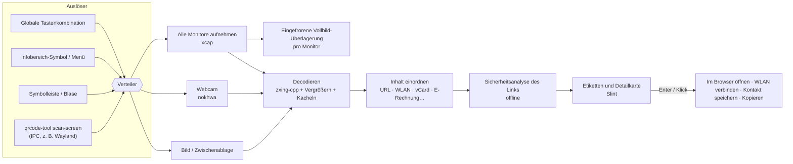

# QRcode tool


 · [English](../../README.md) · [繁體中文](README.zh-TW.md) · [简体中文](README.zh-CN.md) · [Español](README.es.md) · [Português (Brasil)](README.pt-BR.md) · [日本語](README.ja.md) · [한국어](README.ko.md) · [Français](README.fr.md) · **Deutsch** · [Русский](README.ru.md) · 

Tastenkombination drücken → jeder QR-Code auf dem Bildschirm bekommt ein Etikett → Enter drücken.

Funktioniert auch mit der Webcam. Kostenlos, quelloffen und privat.

📘 **Benutzerhandbuch:** [PDF](../manual/QRcode-tool-User-Manual-de.pdf) · [Word](../manual/QRcode-tool-User-Manual-de.docx)


---


## Funktionen


|                                       |                                                                                                                                                                                 |
| ------------------------------------- | ------------------------------------------------------------------------------------------------------------------------------------------------------------------------------- |
| ⚡ **Einfach zu bedienen**              | Drücken Sie Ctrl+Alt+Q (Strg+Alt+Q) oder klicken Sie auf das Symbol im Infobereich, um den Bildschirm einzufrieren. Ein kurzer Scan-Durchlauf findet jeden Code automatisch.     |
| 🏷️ **Link-Etiketten**                 | Jeder Code zeigt den tatsächlichen Websitenamen. Enter öffnet ihn, Tab springt zum nächsten, C kopiert.                                                                          |
| ✂️ **Bereich auswählen**               | Ist ein Code winzig, unscharf oder schräg, ziehen Sie wie mit dem Snipping Tool einen Rahmen darum.                                                                              |
| 📷 **Webcam**                          | Halten Sie einen gedruckten Code oder einen Smartphone-Bildschirm vor die Kamera; die Ergebnisse erscheinen live.                                                                |
| 🛡️ **Linksicherheit**                 | Öffnet nie unerwartet einen Link. Warnt vor ähnlich aussehenden Buchstaben, getarnten Adressen (`bank.com@evil.io`), IP-Adressen, unverschlüsseltem `http`, Kurzlinks und mehr – alles offline. |
| 📶 **Versteht den Inhalt**             | WLAN (Verbinden mit einem Klick), Kontakte (als vCard speichern), E-Mail, Telefon, SMS, Kartenpositionen, Schlüssel für die zweistufige Überprüfung, taiwanische E-Rechnungen (beide Codes zusammengeführt) und Text. |
| 🧾 **Barcodes**                        | EAN, UPC, Code 128, Data Matrix, PDF417, Aztec…                                                                                                                                 |
| 🖼️ **Bilder und Zwischenablage**      | Scannen Sie einen kopierten Screenshot oder eine beliebige Bilddatei.                                                                                                           |
| 🔳 **Einfacher QR-Generator**          | Machen Sie aus einem Link oder Text einen QR-Code; kopieren Sie ihn oder speichern Sie ihn als PNG/SVG.                                                                          |
| 🧰 **Symbolleiste und Blase**          | Eine aufgeräumte schwebende Symbolleiste – als Zeile oben oder als Spalte am rechten oder linken Rand –, die sich zur Blase zusammenklappt und bei Vollbild-Apps automatisch verschwindet. |
| 🎨 **Natives Aussehen**                | Windows-Stil, folgt dem hellen/dunklen Modus und Ihrer Akzentfarbe.                                                                                                             |
| 🌍 **10 Sprachen**                     | English, 繁體中文, 简体中文, Español, Português (Brasil), 日本語, 한국어, Français, Deutsch, Русский.                                                                                         |
| 🔒 **Privat**                          | Alles läuft auf Ihrem Computer. Kein Konto, keine Telemetrie, keine Online-Prüfung von Links. Der Verlauf ist standardmäßig aus.                                                 |
| ☁️ **Leicht und schnell**              | Ein nativer Rust-Kern mit mehr Leistung und weniger Speicherbedarf.                                                                                                             |


## Demo


|                                                                                                                                  |                                                                                                                                   |
| -------------------------------------------------------------------------------------------------------------------------------- | --------------------------------------------------------------------------------------------------------------------------------- |
|  Verdächtige Links nennen den Grund – und warten auf Sie. |  WLAN-Codes verbinden mit einem Klick; das Kennwort bleibt verborgen. |
|  Scannen Sie die Zwischenablage oder eine Bilddatei.        |  Erstellen Sie einen QR-Code.                                                  |
|  Einstellungen im Stil von Windows 11.                                                  |  Folgt dem dunklen Modus und Ihrer Akzentfarbe.                                  |


## Architektur




Die App ist ein Cargo-Workspace: ein schlankes UI-Crate auf kleinen, gut testbaren Bibliotheken.
Threads, Datenfluss und Designentscheidungen beschreibt **[docs/ARCHITECTURE.md](../ARCHITECTURE.md)** (Englisch).

**Technische Details**

#### Decodierstrategie

- [zxing-cpp](https://github.com/zxing-cpp/zxing-cpp) liest den eingefrorenen Screenshot jedes Monitors parallel.
- Kleine Bildschirme werden zusätzlich in doppelter Größe gelesen; große Bildschirme werden außerdem in überlappende 900-px-Kacheln geteilt, sodass auch ein kleiner Code auf einem 4K-Monitor gefunden wird.
- Die Bereichsauswahl fügt einen Leerraum hinzu und vergrößert den Ausschnitt 2- bis 3-fach.
- Die Webcam decodiert in einem eigenen Thread das neueste Bild, und ein Code muss in drei aufeinanderfolgenden Bildern gesehen werden, bevor er zählt.


#### DPI und mehrere Monitore

- Der Bildschirm wird zuerst aufgenommen, und jede Überlagerung zeigt dieses eingefrorene Bild. Alle Koordinaten bleiben in Screenshot-Pixeln und werden in der Oberfläche skaliert, sodass gemischte DPI-Umgebungen ohne Umrechnungsfehler funktionieren.


#### Regeln für die Linksicherheit

- Nur `http`-/`https`-Links lassen sich öffnen; jedes andere Schema wird angezeigt und kann nur kopiert werden.
- Nichts wird an eine Shell übergeben. Links öffnen sich über die Browser-API des Systems.
- Warnungen: unverschlüsseltes `http`, Tarnung mit Benutzerinformationen (`a.com@b.com`), internationale Domänen (zeigt den Punycode), gemischte Alphabete in einem Namensteil, IP-Adressen, ungewöhnliche Ports, Kurzlinks, sehr lange oder stark codierte URLs, tiefe Subdomänen-Ketten.
- Links öffnen sich nie automatisch, außer sie sind der *einzige* gefundene Code, haben *keine* Warnung, und die Website steht auf Ihrer *Vertrauensliste*.
- Kurzlinks werden **nicht** online aufgelöst (das würde dem Kurzlink-Dienst verraten, was Sie gescannt haben).


#### Hinweise zu den Plattformen


|                                | Windows 10 21H2+ / 11 | macOS 13+                                   | Linux X11           | Linux Wayland                                                       |
| ------------------------------ | --------------------- | ------------------------------------------- | ------------------- | ------------------------------------------------------------------- |
| Bildschirmscan                 | ✅                     | ✅ (Berechtigung „Bildschirmaufnahme“)        | ✅                   | ⚠️ über Portal / Compositor                                         |
| Globale Tastenkombination      | ✅                     | ✅                                           | ✅                   | ➖ `qrcode-tool scan-screen` in den Systemeinstellungen zuweisen     |
| Bei Vollbild-Apps ausblenden   | ✅                     | ➖                                           | ➖                   | ➖                                                                   |
| Updates                        | in der App (Velopack) | in der App                                  | in der App (AppImage) | in der App (AppImage)                                             |


#### Sensible Daten

- Geheimnisse für die zweistufige Überprüfung und WLAN-Kennwörter werden nie in den Verlauf geschrieben und nie automatisch kopiert.
- Protokolle enthalten nur Ereignisse und Fehler, nie gescannte Inhalte.


## Installation


### Windows 10 (21H2+) / 11 — x64 und ARM64

1. Laden Sie `QRcodeTool-win-x64-Setup.exe` (oder `…-arm64-…`) von der [neuesten Version](https://github.com/naritaroad/qrcode-tool/releases/latest) herunter.
2. Führen Sie die Datei aus. QRcode tool wird nur für Ihren Benutzer installiert (ohne Administratorrechte) und startet im Infobereich.
3. Drücken Sie Ctrl+Alt+Q zum Scannen (ändern Sie die Kombination unter *Einstellungen › Tastenkombinationen*, falls eine andere App sie bereits verwendet). Ein Rechtsklick auf den Desktop oder ein Bild bietet dieselben Funktionen (*Einstellungen › Allgemein › Rechtsklickmenü*). Öffnen Sie unter Windows 11 **Weitere Optionen anzeigen**.

> **„Der Computer wurde durch Windows geschützt“?** Frühe Versionen sind noch nicht codesigniert, daher kann SmartScreen vor einem unbekannten Herausgeber warnen. Klicken Sie auf **Weitere Informationen → Trotzdem ausführen**. Sie können den Download mit den SHA-256-Prüfsummen prüfen, die mit jeder Version veröffentlicht werden. Siehe [FAQ](../FAQ.md#windows-smartscreen) (Englisch).

Es gibt auch eine **portable** `.zip` (ohne Installationsprogramm, ohne automatische Updates).

### macOS 13+ (Apple Silicon und Intel)

Laden Sie die `.pkg` von der [neuesten Version](https://github.com/naritaroad/qrcode-tool/releases/latest) herunter. Erlauben Sie beim ersten Scan unter *Systemeinstellungen › Datenschutz & Sicherheit* die **Bildschirmaufnahme** (und **Kamera** für das Scannen mit der Webcam). Die Versionen sind noch nicht notariell beglaubigt – klicken Sie beim ersten Mal mit der rechten Maustaste auf die App und wählen Sie **Öffnen**.

### Linux

Laden Sie das `.AppImage` herunter, machen Sie es ausführbar und starten Sie es. Unter Wayland legen Sie in den Desktop-Einstellungen eine Tastenkombination an, die `qrcode-tool scan-screen` ausführt.

### Aus dem Quellcode bauen

```bash
git clone https://github.com/naritaroad/qrcode-tool
cd qrcode-tool
cargo run --release
```

Sie brauchen Rust 1.85+, CMake und einen C++-Compiler (für zxing-cpp). Details für jede Plattform: **[docs/BUILDING.md](../BUILDING.md)** (Englisch).

### Befehlszeile

```text
qrcode-tool                     starten (oder die Symbolleiste zeigen, wenn es schon läuft)
qrcode-tool scan-screen         den Bildschirm scannen
qrcode-tool scan-region         den Bildschirm einfrieren und einen Rahmen ziehen
qrcode-tool scan-camera         mit der Webcam scannen
qrcode-tool scan-clipboard      das Bild in der Zwischenablage scannen
qrcode-tool scan-file DATEI     eine Bilddatei scannen
qrcode-tool show-toolbar        die schwebende Symbolleiste zeigen
qrcode-tool generate "TEXT"     einen QR-Code erstellen
qrcode-tool decode DATEI… [--json]   Bilder ohne Oberfläche decodieren
```


## Projektstruktur

```text
qrcode-tool/
├─ app/                    # Die Desktop-App (Slint-Oberfläche + Verbindungscode)
│  ├─ src/                 #   Infobereich, Tastenkombinationen, Überlagerung, Vorschau, Einstellungen, Updater…
│  ├─ ui/                  #   .slint-Fenster, Widgets, Symbole
│  └─ translations/        #   .po-Dateien für 9 Sprachen
├─ crates/
│  ├─ qrtool-core/         # Inhaltsanalyse, Linksicherheit, Einstellungen, Verlauf (reines Rust)
│  ├─ qrtool-decode/       # zxing-cpp-Decodierstrategie + QR-Erzeugung
│  ├─ qrtool-capture/      # Screenshots aller Monitore (xcap)
│  ├─ qrtool-camera/       # Webcam-Aufnahme + Live-Decodierung (nokhwa)
│  └─ qrtool-platform/     # Systemintegration: Öffnen, Autostart, Design, WLAN, IPC, Zwischenablage, Kontextmenü
├─ assets/icons/           # App- und Infobereich-Symbole
├─ packaging/              # MSIX, Linux-Desktop-Eintrag, macOS-Bundle-Infos
├─ docs/                   # Architektur, Bauen, FAQ, Datenschutz, Übersetzungen
│  └─ manual/              #   Benutzerhandbuch (PDF + Word, 10 Sprachen) und seine Build-Skripte
└─ .github/workflows/      # CI und Release-Pipeline
```


## Mitwirken

Beiträge sind willkommen – Fehlerberichte, Übersetzungen, Code und Ideen.

- Lesen Sie zum Einstieg **[CONTRIBUTING.md](../../CONTRIBUTING.md)**.
- Eine Übersetzung verbessern: **[docs/TRANSLATING.md](../TRANSLATING.md)** (die aktuellen Übersetzungen sind geprüfte maschinelle Übersetzungen; Muttersprachler sind sehr willkommen).
- Ein Sicherheitsproblem gefunden? Bitte folgen Sie **[SECURITY.md](../../SECURITY.md)**, statt ein öffentliches Issue zu eröffnen.
- Von allen Beteiligten wird erwartet, dass sie den **[Verhaltenskodex](../../CODE_OF_CONDUCT.md)** einhalten.

Wenn Ihnen QRcode tool Zeit spart, können Sie [das Projekt unterstützen](https://github.com/sponsors/naritaroad). ❤️

## Lizenz

Lizenziert nach Ihrer Wahl unter einer der folgenden Lizenzen:

- Apache License, Version 2.0 ([LICENSE-APACHE](../../LICENSE-APACHE))
- MIT license ([LICENSE-MIT](../../LICENSE-MIT))

Sofern Sie nicht ausdrücklich etwas anderes angeben, steht jeder Beitrag, den Sie zur Aufnahme in dieses Projekt einreichen, ohne zusätzliche Bedingungen unter der obigen Doppellizenz.

Komponenten von Drittanbietern und ihre Lizenzen sind in [THIRD_PARTY_NOTICES.md](../../THIRD_PARTY_NOTICES.md) aufgeführt. Die Oberfläche ist mit [Slint](https://slint.dev) unter der Slint Royalty-free Desktop License gebaut.

### Verwandte Projekte

QRcode tool wurde von diesen Projekten inspiriert. Es wurde kein Code daraus übernommen; danke, dass sie gezeigt haben, was QR-Scannen am Desktop sein kann:

- [qrpeek](https://github.com/dzoffice/qrpeek) — Werkzeug zur Erkennung von QR-Codes auf dem Bildschirm
- [ScreenQRScanner](https://github.com/Konyaco/ScreenQRScanner) — QR-Code-Scanner für den Bildschirm
- [QR-Code-Reader](https://github.com/ottozumkeller/QR-Code-Reader) — Lesegerät auf Basis von Snipping Tool und ZXing.Net
- [NormCap](https://github.com/dynobo/normcap) — Bildschirmaufnahme mit OCR
- [ShareX](https://github.com/ShareX/ShareX) — Screenshot-Suite mit QR-Code-Werkzeug
- [CodeTwo QR Code Desktop Reader](https://www.codetwo.com/freeware/qr-code-desktop-reader/) — kostenloser Desktop-Reader

Aufgebaut auf [zxing-cpp](https://github.com/zxing-cpp/zxing-cpp), [Slint](https://github.com/slint-ui/slint), [xcap](https://github.com/nashaofu/xcap), [nokhwa](https://github.com/l1npengtul/nokhwa), [global-hotkey](https://github.com/tauri-apps/global-hotkey), [Velopack](https://github.com/velopack/velopack) und [qrcode](https://github.com/kennytm/qrcode-rust).

---

QR Code ist eine eingetragene Marke der DENSO WAVE INCORPORATED. QRcode tool steht in keiner Verbindung zu DENSO WAVE, Google oder Microsoft.
