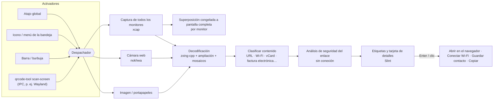

# QRcode tool


 · [English](../../README.md) · [繁體中文](README.zh-TW.md) · [简体中文](README.zh-CN.md) · **Español** · [Português (Brasil)](README.pt-BR.md) · [日本語](README.ja.md) · [한국어](README.ko.md) · [Français](README.fr.md) · [Deutsch](README.de.md) · [Русский](README.ru.md) · 

Pulsa un atajo → cada código QR de la pantalla recibe una etiqueta → pulsa Enter.

También funciona con la cámara web. Gratis, de código abierto y privado.

📘 **Manual de usuario:** [PDF](../manual/QRcode-tool-User-Manual-es.pdf) · [Word](../manual/QRcode-tool-User-Manual-es.docx)


---


## Funciones


|                                    |                                                                                                                                                                          |
| ---------------------------------- | ------------------------------------------------------------------------------------------------------------------------------------------------------------------------ |
| ⚡ **Fácil de usar**                 | Pulsa Ctrl+Alt+Q, o haz clic en el icono de la bandeja, para congelar la pantalla. Un barrido rápido encuentra todos los códigos automáticamente.                         |
| 🏷️ **Etiquetas de enlace**         | Cada código muestra el nombre real del sitio. Enter lo abre, Tab pasa al siguiente y C copia.                                                                            |
| ✂️ **Seleccionar un área**          | Si un código es diminuto, borroso o está inclinado, arrastra un recuadro a su alrededor como con una herramienta de recorte.                                              |
| 📷 **Cámara web**                   | Acerca a la cámara un código impreso o la pantalla de un teléfono; los resultados aparecen en directo.                                                                   |
| 🛡️ **Seguridad de enlaces**        | Nunca abre un enlace por sorpresa. Avisa de letras parecidas, direcciones disfrazadas (`bank.com@evil.io`), direcciones IP, `http` sin cifrar, enlaces acortados y más, todo sin conexión. |
| 📶 **Entiende el contenido**        | Wi-Fi (conexión con un clic), contactos (se guardan como vCard), correo, teléfono, SMS, ubicaciones, claves de verificación en dos pasos, facturas electrónicas de Taiwán (los dos códigos se combinan) y texto. |
| 🧾 **Códigos de barras**            | EAN, UPC, Code 128, Data Matrix, PDF417, Aztec…                                                                                                                          |
| 🖼️ **Imágenes y portapapeles**     | Escanea una captura que hayas copiado o cualquier archivo de imagen.                                                                                                     |
| 🔳 **Generador de QR sencillo**     | Convierte un enlace o un texto en un código QR; cópialo o guárdalo como PNG/SVG.                                                                                         |
| 🧰 **Barra y burbuja**              | Una barra flotante limpia (una fila arriba o una columna en el borde derecho o izquierdo) que se contrae en una burbuja y se oculta sola con las aplicaciones a pantalla completa. |
| 🎨 **Aspecto nativo**               | Estilo de Windows; sigue el modo claro/oscuro y tu color de énfasis.                                                                                                     |
| 🌍 **10 idiomas**                   | English, 繁體中文, 简体中文, Español, Português (Brasil), 日本語, 한국어, Français, Deutsch, Русский.                                                                                  |
| 🔒 **Privado**                      | Todo se ejecuta en tu computadora. Sin cuenta, sin telemetría, sin comprobaciones de enlaces en línea. El historial está desactivado de forma predeterminada.             |
| ☁️ **Ligero y rápido**              | Un núcleo nativo en Rust, con más rendimiento y menos uso de memoria.                                                                                                    |


## Demostración


|                                                                                                                                 |                                                                                                                                    |
| ------------------------------------------------------------------------------------------------------------------------------- | ---------------------------------------------------------------------------------------------------------------------------------- |
|  Los enlaces sospechosos explican por qué y te esperan. |  Los códigos Wi-Fi se conectan con un clic; la contraseña queda oculta. |
|  Escanea el portapapeles o un archivo de imagen.              |  Crea un código QR.                                                                 |
|  Configuración al estilo de Windows 11.                                                 |  Sigue el modo oscuro y tu color de énfasis.                                        |


## Arquitectura




La aplicación es un workspace de Cargo: un crate de interfaz delgado sobre bibliotecas pequeñas y fáciles de probar.
Consulta **[docs/ARCHITECTURE.md](../ARCHITECTURE.md)** (en inglés) para ver los hilos, el flujo de datos y las decisiones de diseño.

**Detalles técnicos**

#### Estrategia de decodificación

- [zxing-cpp](https://github.com/zxing-cpp/zxing-cpp) lee en paralelo la captura congelada de cada monitor.
- Las pantallas pequeñas se leen también al doble de tamaño; las grandes se dividen además en mosaicos solapados de 900 px, así que un código pequeño en un monitor 4K se sigue encontrando.
- La selección de área añade una zona en blanco y amplía el recorte 2–3 veces.
- La cámara web decodifica el fotograma más reciente en su propio hilo, y un código tiene que verse en tres fotogramas seguidos para contar.


#### DPI y varios monitores

- Primero se captura la pantalla y cada superposición muestra esa imagen congelada. Todas las coordenadas se quedan en píxeles de la captura y se escalan dentro de la interfaz, así que las configuraciones con DPI mixtos funcionan sin errores de conversión.


#### Reglas de seguridad de enlaces

- Solo se pueden abrir enlaces `http`/`https`; cualquier otro esquema se muestra y solo se puede copiar.
- Nada se pasa a un shell. Los enlaces se abren con la API del navegador del sistema.
- Advertencias: `http` sin cifrar, disfraz con información de usuario (`a.com@b.com`), dominios internacionales (se muestra el punycode), alfabetos mezclados en una misma etiqueta, direcciones IP, puertos inusuales, enlaces acortados, URL muy largas o muy codificadas y cadenas profundas de subdominios.
- Los enlaces nunca se abren automáticamente salvo que sean el *único* código encontrado, no tengan *ninguna* advertencia y el sitio esté en tu *lista de confianza*.
- Los enlaces acortados **no** se expanden en línea (eso le diría al acortador qué escaneaste).


#### Notas por plataforma


|                                   | Windows 10 21H2+ / 11 | macOS 13+                                  | Linux X11         | Linux Wayland                                                  |
| --------------------------------- | --------------------- | ------------------------------------------ | ----------------- | -------------------------------------------------------------- |
| Escaneo de pantalla               | ✅                     | ✅ (permiso de Grabación de pantalla)        | ✅                 | ⚠️ vía portal / compositor                                     |
| Atajo global                      | ✅                     | ✅                                          | ✅                 | ➖ asigna `qrcode-tool scan-screen` en la configuración del sistema |
| Ocultar con apps a pantalla completa | ✅                  | ➖                                          | ➖                 | ➖                                                              |
| Actualizaciones                   | en la app (Velopack)  | en la app                                  | en la app (AppImage) | en la app (AppImage)                                         |


#### Datos sensibles

- Los secretos de verificación en dos pasos y las contraseñas Wi-Fi nunca se escriben en el historial ni se copian automáticamente.
- Los registros solo contienen eventos y errores, nunca contenido escaneado.


## Instalación


### Windows 10 (21H2+) / 11 — x64 y ARM64

1. Descarga `QRcodeTool-win-x64-Setup.exe` (o `…-arm64-…`) desde la [última versión](https://github.com/naritaroad/qrcode-tool/releases/latest).
2. Ejecútalo. QRcode tool se instala solo para tu usuario (sin permisos de administrador) y se inicia en la bandeja.
3. Pulsa Ctrl+Alt+Q para escanear (cámbialo en *Configuración › Métodos abreviados* si otra aplicación ya lo usa). Haz clic derecho en el escritorio o en una imagen para usar las mismas herramientas (*Configuración › General › Menú del clic derecho*). En Windows 11, abre **Mostrar más opciones**.

> **¿“Windows protegió su PC”?** Las primeras versiones aún no tienen firma de código, así que SmartScreen puede advertir de un editor desconocido. Haz clic en **Más información → Ejecutar de todas formas**. Puedes verificar la descarga con las sumas SHA-256 publicadas en cada versión. Consulta las [preguntas frecuentes](../FAQ.md#windows-smartscreen) (en inglés).

También hay un `.zip` **portátil** (sin instalador ni actualizaciones automáticas).

### macOS 13+ (Apple silicon e Intel)

Descarga el `.pkg` desde la [última versión](https://github.com/naritaroad/qrcode-tool/releases/latest). En el primer escaneo, permite **Grabación de pantalla** (y **Cámara** para escanear con la cámara web) en *Ajustes del Sistema › Privacidad y seguridad*. Las versiones aún no están notarizadas: la primera vez, haz clic derecho en la app y elige **Abrir**.

### Linux

Descarga el `.AppImage`, hazlo ejecutable y ejecútalo. En Wayland, añade en la configuración del escritorio un atajo de teclado que ejecute `qrcode-tool scan-screen`.

### Compilar desde el código fuente

```bash
git clone https://github.com/naritaroad/qrcode-tool
cd qrcode-tool
cargo run --release
```

Necesitas Rust 1.85+, CMake y un compilador de C++ (para zxing-cpp). Detalles para cada plataforma: **[docs/BUILDING.md](../BUILDING.md)** (en inglés).

### Línea de comandos

```text
qrcode-tool                     iniciar (o mostrar la barra si ya se está ejecutando)
qrcode-tool scan-screen         escanear la pantalla
qrcode-tool scan-region         congelar la pantalla y arrastrar un recuadro
qrcode-tool scan-camera         escanear con la cámara web
qrcode-tool scan-clipboard      escanear la imagen del portapapeles
qrcode-tool scan-file ARCHIVO   escanear un archivo de imagen
qrcode-tool show-toolbar        mostrar la barra de herramientas flotante
qrcode-tool generate "TEXTO"    crear un código QR
qrcode-tool decode ARCHIVO… [--json]   decodificar imágenes sin la interfaz
```


## Estructura del proyecto

```text
qrcode-tool/
├─ app/                    # La aplicación de escritorio (interfaz Slint + código de unión)
│  ├─ src/                 #   bandeja, atajos, superposición, vista previa, configuración, actualizador…
│  ├─ ui/                  #   ventanas .slint, widgets, iconos
│  └─ translations/        #   archivos .po de 9 idiomas
├─ crates/
│  ├─ qrtool-core/         # Análisis de contenido, seguridad de enlaces, configuración, historial (Rust puro)
│  ├─ qrtool-decode/       # Estrategia de decodificación con zxing-cpp + generación de QR
│  ├─ qrtool-capture/      # Capturas de varios monitores (xcap)
│  ├─ qrtool-camera/       # Captura de la cámara web + decodificación en directo (nokhwa)
│  └─ qrtool-platform/     # Integración con el sistema: abrir, inicio automático, tema, Wi-Fi, IPC, portapapeles, menú contextual
├─ assets/icons/           # Iconos de la aplicación y de la bandeja
├─ packaging/              # MSIX, entrada de escritorio de Linux, información del paquete de macOS
├─ docs/                   # Arquitectura, compilación, preguntas frecuentes, privacidad, traducciones
│  └─ manual/              #   Manual de usuario (PDF + Word, 10 idiomas) y sus scripts de generación
└─ .github/workflows/      # CI y proceso de publicación
```


## Contribuir

Las contribuciones son bienvenidas: informes de errores, traducciones, código e ideas.

- Lee **[CONTRIBUTING.md](../../CONTRIBUTING.md)** para empezar.
- Mejora una traducción: **[docs/TRANSLATING.md](../TRANSLATING.md)** (las traducciones actuales son traducciones automáticas revisadas; la ayuda de hablantes nativos es muy bienvenida).
- ¿Encontraste un problema de seguridad? Sigue **[SECURITY.md](../../SECURITY.md)** en lugar de abrir una incidencia pública.
- Se espera que todas las personas participantes sigan el **[código de conducta](../../CODE_OF_CONDUCT.md)**.

Si QRcode tool te ahorra tiempo, puedes [patrocinar el proyecto](https://github.com/sponsors/naritaroad). ❤️

## Licencia

Se distribuye bajo cualquiera de estas licencias, a tu elección:

- Apache License, Version 2.0 ([LICENSE-APACHE](../../LICENSE-APACHE))
- MIT license ([LICENSE-MIT](../../LICENSE-MIT))

Salvo que indiques expresamente lo contrario, cualquier contribución que envíes para incluirla en este proyecto tendrá la doble licencia anterior, sin términos ni condiciones adicionales.

Los componentes de terceros y sus licencias se enumeran en [THIRD_PARTY_NOTICES.md](../../THIRD_PARTY_NOTICES.md). La interfaz está hecha con [Slint](https://slint.dev) bajo la Slint Royalty-free Desktop License.

### Proyectos relacionados

QRcode tool se inspiró en estos proyectos. No se copió código de ninguno de ellos; gracias por mostrar lo que puede ser el escaneo de QR en el escritorio:

- [qrpeek](https://github.com/dzoffice/qrpeek) — herramienta de reconocimiento de códigos QR en pantalla
- [ScreenQRScanner](https://github.com/Konyaco/ScreenQRScanner) — escáner de códigos QR en pantalla
- [QR-Code-Reader](https://github.com/ottozumkeller/QR-Code-Reader) — lector basado en la Herramienta Recortes y ZXing.Net
- [NormCap](https://github.com/dynobo/normcap) — captura de pantalla con OCR
- [ShareX](https://github.com/ShareX/ShareX) — suite de captura de pantalla con herramienta de códigos QR
- [CodeTwo QR Code Desktop Reader](https://www.codetwo.com/freeware/qr-code-desktop-reader/) — lector de escritorio gratuito

Construido sobre [zxing-cpp](https://github.com/zxing-cpp/zxing-cpp), [Slint](https://github.com/slint-ui/slint), [xcap](https://github.com/nashaofu/xcap), [nokhwa](https://github.com/l1npengtul/nokhwa), [global-hotkey](https://github.com/tauri-apps/global-hotkey), [Velopack](https://github.com/velopack/velopack) y [qrcode](https://github.com/kennytm/qrcode-rust).

---

QR Code es una marca registrada de DENSO WAVE INCORPORATED. QRcode tool no está afiliado a DENSO WAVE, Google ni Microsoft.
