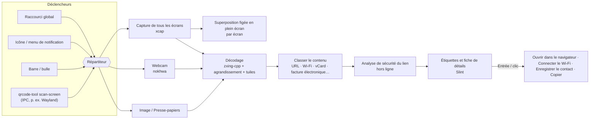

# QRcode tool


 · [English](../../README.md) · [繁體中文](README.zh-TW.md) · [简体中文](README.zh-CN.md) · [Español](README.es.md) · [Português (Brasil)](README.pt-BR.md) · [日本語](README.ja.md) · [한국어](README.ko.md) · **Français** · [Deutsch](README.de.md) · [Русский](README.ru.md) · 

Appuyez sur un raccourci → chaque code QR à l’écran reçoit une étiquette → appuyez sur Entrée.

Fonctionne aussi avec votre webcam. Gratuit, open source et respectueux de la vie privée.

📘 **Manuel d’utilisation :** [PDF](../manual/QRcode-tool-User-Manual-fr.pdf) · [Word](../manual/QRcode-tool-User-Manual-fr.docx)


---


## Fonctionnalités


|                                       |                                                                                                                                                                                  |
| ------------------------------------- | -------------------------------------------------------------------------------------------------------------------------------------------------------------------------------- |
| ⚡ **Simple à utiliser**                | Appuyez sur Ctrl+Alt+Q, ou cliquez sur l’icône de notification, pour figer l’écran. Un balayage rapide trouve automatiquement tous les codes.                                     |
| 🏷️ **Étiquettes de lien**             | Chaque code affiche le vrai nom du site. Entrée l’ouvre, Tab passe au suivant, C copie.                                                                                          |
| ✂️ **Sélectionner une zone**           | Quand un code est minuscule, flou ou incliné, tracez un cadre autour, comme avec l’Outil Capture.                                                                                |
| 📷 **Webcam**                          | Présentez à la caméra un code imprimé ou l’écran d’un téléphone ; les résultats s’affichent en direct.                                                                           |
| 🛡️ **Sécurité des liens**             | N’ouvre jamais un lien par surprise. Signale les lettres similaires, les adresses déguisées (`bank.com@evil.io`), les adresses IP, le `http` non chiffré, les liens raccourcis et plus encore — entièrement hors ligne. |
| 📶 **Comprend le contenu**             | Wi-Fi (connexion en un clic), contacts (enregistrés en vCard), e-mail, téléphone, SMS, positions, clés de vérification en deux étapes, factures électroniques de Taïwan (les deux codes fusionnés) et texte. |
| 🧾 **Codes-barres**                    | EAN, UPC, Code 128, Data Matrix, PDF417, Aztec…                                                                                                                                  |
| 🖼️ **Images et Presse-papiers**       | Scannez une capture d’écran copiée ou n’importe quel fichier image.                                                                                                              |
| 🔳 **Générateur de QR simple**         | Transformez un lien ou un texte en code QR ; copiez-le ou enregistrez-le en PNG/SVG.                                                                                             |
| 🧰 **Barre et bulle**                  | Une barre flottante épurée — une rangée en haut ou une colonne sur le bord droit ou gauche — qui se réduit en bulle et se masque d’elle-même pendant les applications en plein écran. |
| 🎨 **Aspect natif**                    | Style Windows ; suit le mode clair/sombre et votre couleur d’accentuation.                                                                                                       |
| 🌍 **10 langues**                      | English, 繁體中文, 简体中文, Español, Português (Brasil), 日本語, 한국어, Français, Deutsch, Русский.                                                                                          |
| 🔒 **Confidentiel**                    | Tout s’exécute sur votre ordinateur. Pas de compte, pas de télémétrie, pas de vérification de liens en ligne. L’historique est désactivé par défaut.                              |
| ☁️ **Léger et rapide**                 | Un cœur natif en Rust, pour plus de performances et moins de mémoire utilisée.                                                                                                   |


## Démonstration


|                                                                                                                              |                                                                                                                                 |
| ---------------------------------------------------------------------------------------------------------------------------- | ------------------------------------------------------------------------------------------------------------------------------- |
|  Les liens suspects expliquent pourquoi — et vous attendent. |  Les codes Wi-Fi se connectent en un clic ; le mot de passe reste masqué. |
|  Scannez le Presse-papiers ou un fichier image.               |  Créez un code QR.                                                                  |
|  Paramètres dans le style de Windows 11.                                                |  Suit le mode sombre et votre couleur d’accentuation.                            |


## Architecture




L’application est un workspace Cargo : un crate d’interface fin au-dessus de petites bibliothèques faciles à tester.
Voir **[docs/ARCHITECTURE.md](../ARCHITECTURE.md)** (en anglais) pour les threads, le flux de données et les choix de conception.

**Détails techniques**

#### Stratégie de décodage

- [zxing-cpp](https://github.com/zxing-cpp/zxing-cpp) lit en parallèle la capture figée de chaque écran.
- Les petits écrans sont aussi lus à l’échelle 2× ; les grands écrans sont en plus découpés en tuiles de 900 px qui se chevauchent, si bien qu’un petit code sur un écran 4K est quand même trouvé.
- La sélection de zone ajoute une marge blanche et agrandit la découpe 2 à 3 fois.
- La webcam décode l’image la plus récente dans son propre thread, et un code doit être vu sur trois images consécutives pour compter.


#### DPI et écrans multiples

- L’écran est d’abord capturé, puis chaque superposition affiche cette image figée. Toutes les coordonnées restent en pixels de capture et sont mises à l’échelle dans l’interface : les configurations à DPI mixtes fonctionnent sans erreurs de conversion.


#### Règles de sécurité des liens

- Seuls les liens `http`/`https` peuvent être ouverts ; tout autre schéma est affiché et peut seulement être copié.
- Rien n’est transmis à un shell. Les liens s’ouvrent avec l’API de navigateur du système.
- Avertissements : `http` non chiffré, déguisement par informations d’utilisateur (`a.com@b.com`), domaines internationaux (affiche le punycode), alphabets mélangés dans un même libellé, adresses IP, ports inhabituels, liens raccourcis, URL très longues ou très encodées, longues chaînes de sous-domaines.
- Les liens ne s’ouvrent jamais automatiquement, sauf s’ils sont le *seul* code trouvé, n’ont *aucun* avertissement et que le site est dans votre *liste de confiance*.
- Les liens raccourcis ne sont **pas** dépliés en ligne (cela révélerait au service de raccourcissement ce que vous avez scanné).


#### Notes par plateforme


|                                     | Windows 10 21H2+ / 11 | macOS 13+                                   | Linux X11              | Linux Wayland                                                  |
| ----------------------------------- | --------------------- | ------------------------------------------- | ---------------------- | -------------------------------------------------------------- |
| Scan de l’écran                     | ✅                     | ✅ (autorisation d’enregistrement de l’écran) | ✅                      | ⚠️ via portail / compositeur                                   |
| Raccourci global                    | ✅                     | ✅                                           | ✅                      | ➖ associez `qrcode-tool scan-screen` dans les réglages système |
| Masquer en plein écran              | ✅                     | ➖                                           | ➖                      | ➖                                                              |
| Mises à jour                        | dans l’app (Velopack) | dans l’app                                  | dans l’app (AppImage)  | dans l’app (AppImage)                                          |


#### Données sensibles

- Les secrets de vérification en deux étapes et les mots de passe Wi-Fi ne sont jamais écrits dans l’historique ni copiés automatiquement.
- Les journaux ne contiennent que des événements et des erreurs, jamais de contenu scanné.


## Installation


### Windows 10 (21H2+) / 11 — x64 et ARM64

1. Téléchargez `QRcodeTool-win-x64-Setup.exe` (ou `…-arm64-…`) depuis la [dernière version](https://github.com/naritaroad/qrcode-tool/releases/latest).
2. Lancez-le. QRcode tool s’installe pour votre seul utilisateur (sans droits d’administrateur) et démarre dans la zone de notification.
3. Appuyez sur Ctrl+Alt+Q pour scanner (changez-le dans *Paramètres › Raccourcis* si une autre application l’utilise déjà). Faites un clic droit sur le Bureau ou sur une image pour accéder aux mêmes outils (*Paramètres › Général › Menu contextuel*). Sous Windows 11, ouvrez **Afficher d’autres options**.

> **« Windows a protégé votre ordinateur » ?** Les premières versions ne sont pas encore signées numériquement ; SmartScreen peut donc signaler un éditeur inconnu. Cliquez sur **Informations complémentaires → Exécuter quand même**. Vous pouvez vérifier le téléchargement grâce aux sommes SHA-256 publiées avec chaque version. Voir la [FAQ](../FAQ.md#windows-smartscreen) (en anglais).

Un `.zip` **portable** est aussi disponible (sans installateur ni mises à jour automatiques).

### macOS 13+ (Apple silicon et Intel)

Téléchargez le `.pkg` depuis la [dernière version](https://github.com/naritaroad/qrcode-tool/releases/latest). Au premier scan, autorisez **Enregistrement de l’écran** (et **Caméra** pour le scan par webcam) dans *Réglages Système › Confidentialité et sécurité*. Les versions ne sont pas encore notariées : la première fois, faites un clic droit sur l’app et choisissez **Ouvrir**.

### Linux

Téléchargez l’`.AppImage`, rendez-la exécutable et lancez-la. Sous Wayland, ajoutez dans les réglages du bureau un raccourci clavier qui exécute `qrcode-tool scan-screen`.

### Compiler depuis les sources

```bash
git clone https://github.com/naritaroad/qrcode-tool
cd qrcode-tool
cargo run --release
```

Il faut Rust 1.85+, CMake et un compilateur C++ (pour zxing-cpp). Détails pour chaque plateforme : **[docs/BUILDING.md](../BUILDING.md)** (en anglais).

### Ligne de commande

```text
qrcode-tool                     démarrer (ou afficher la barre s’il tourne déjà)
qrcode-tool scan-screen         scanner l’écran
qrcode-tool scan-region         figer l’écran et tracer un cadre
qrcode-tool scan-camera         scanner avec la webcam
qrcode-tool scan-clipboard      scanner l’image du Presse-papiers
qrcode-tool scan-file FICHIER   scanner un fichier image
qrcode-tool show-toolbar        afficher la barre d’outils flottante
qrcode-tool generate "TEXTE"    créer un code QR
qrcode-tool decode FICHIER… [--json]   décoder des images sans l’interface
```


## Structure du projet

```text
qrcode-tool/
├─ app/                    # L’application de bureau (interface Slint + code de liaison)
│  ├─ src/                 #   zone de notification, raccourcis, superposition, aperçu, paramètres, mises à jour…
│  ├─ ui/                  #   fenêtres .slint, widgets, icônes
│  └─ translations/        #   fichiers .po pour 9 langues
├─ crates/
│  ├─ qrtool-core/         # Analyse du contenu, sécurité des liens, paramètres, historique (Rust pur)
│  ├─ qrtool-decode/       # Stratégie de décodage zxing-cpp + génération de QR
│  ├─ qrtool-capture/      # Captures multi-écrans (xcap)
│  ├─ qrtool-camera/       # Capture webcam + décodage en direct (nokhwa)
│  └─ qrtool-platform/     # Intégration au système : ouverture, démarrage auto, thème, Wi-Fi, IPC, Presse-papiers, menu contextuel
├─ assets/icons/           # Icônes de l’application et de la zone de notification
├─ packaging/              # MSIX, entrée de bureau Linux, informations du paquet macOS
├─ docs/                   # Architecture, compilation, FAQ, confidentialité, traductions
│  └─ manual/              #   Manuel d’utilisation (PDF + Word, 10 langues) et ses scripts de génération
└─ .github/workflows/      # CI et chaîne de publication
```


## Contribuer

Les contributions sont les bienvenues : rapports de bogues, traductions, code et idées.

- Lisez **[CONTRIBUTING.md](../../CONTRIBUTING.md)** pour commencer.
- Améliorer une traduction : **[docs/TRANSLATING.md](../TRANSLATING.md)** (les traductions actuelles sont des traductions automatiques relues ; les locuteurs natifs sont les bienvenus).
- Vous avez trouvé un problème de sécurité ? Suivez **[SECURITY.md](../../SECURITY.md)** au lieu d’ouvrir une issue publique.
- Toutes les personnes qui participent doivent respecter le **[code de conduite](../../CODE_OF_CONDUCT.md)**.

Si QRcode tool vous fait gagner du temps, vous pouvez [soutenir le projet](https://github.com/sponsors/naritaroad). ❤️

## Licence

Distribué, au choix, sous l’une de ces licences :

- Apache License, Version 2.0 ([LICENSE-APACHE](../../LICENSE-APACHE))
- MIT license ([LICENSE-MIT](../../LICENSE-MIT))

Sauf mention contraire explicite de votre part, toute contribution que vous soumettez pour inclusion dans ce projet est placée sous la double licence ci-dessus, sans conditions supplémentaires.

Les composants tiers et leurs licences sont listés dans [THIRD_PARTY_NOTICES.md](../../THIRD_PARTY_NOTICES.md). L’interface est construite avec [Slint](https://slint.dev) sous la Slint Royalty-free Desktop License.

### Projets apparentés

QRcode tool s’inspire de ces projets. Aucun code n’en a été copié ; merci à eux d’avoir montré ce que peut être la lecture de QR codes sur ordinateur :

- [qrpeek](https://github.com/dzoffice/qrpeek) — outil de reconnaissance de codes QR à l’écran
- [ScreenQRScanner](https://github.com/Konyaco/ScreenQRScanner) — scanner de codes QR à l’écran
- [QR-Code-Reader](https://github.com/ottozumkeller/QR-Code-Reader) — lecteur basé sur l’Outil Capture et ZXing.Net
- [NormCap](https://github.com/dynobo/normcap) — capture d’écran avec OCR
- [ShareX](https://github.com/ShareX/ShareX) — suite de capture d’écran avec un outil QR code
- [CodeTwo QR Code Desktop Reader](https://www.codetwo.com/freeware/qr-code-desktop-reader/) — lecteur de bureau gratuit

Construit grâce à [zxing-cpp](https://github.com/zxing-cpp/zxing-cpp), [Slint](https://github.com/slint-ui/slint), [xcap](https://github.com/nashaofu/xcap), [nokhwa](https://github.com/l1npengtul/nokhwa), [global-hotkey](https://github.com/tauri-apps/global-hotkey), [Velopack](https://github.com/velopack/velopack) et [qrcode](https://github.com/kennytm/qrcode-rust).

---

QR Code est une marque déposée de DENSO WAVE INCORPORATED. QRcode tool n’est affilié ni à DENSO WAVE, ni à Google, ni à Microsoft.
