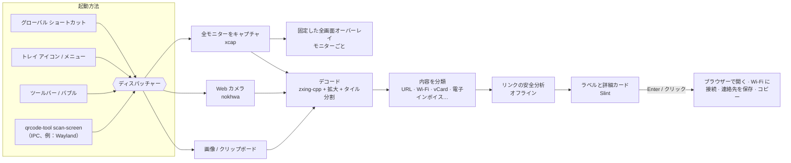

# QRcode tool


 · [English](../../README.md) · [繁體中文](README.zh-TW.md) · [简体中文](README.zh-CN.md) · [Español](README.es.md) · [Português (Brasil)](README.pt-BR.md) · **日本語** · [한국어](README.ko.md) · [Français](README.fr.md) · [Deutsch](README.de.md) · [Русский](README.ru.md) · 

ショートカット キーを押す → 画面上のすべての QR コードにラベルが付く → Enter を押す。

Web カメラでも使えます。無料、オープンソース、プライバシー重視。

📘 **ユーザーマニュアル：**[PDF](../manual/QRcode-tool-User-Manual-ja.pdf) · [Word](../manual/QRcode-tool-User-Manual-ja.docx)


---


## 機能


|                            |                                                                                                                          |
| -------------------------- | ------------------------------------------------------------------------------------------------------------------------ |
| ⚡ **かんたん操作**               | Ctrl+Alt+Q を押すかトレイ アイコンをクリックすると画面が固定され、すばやいスキャン アニメーションですべてのコードを自動で見つけます。                                              |
| 🏷️ **リンク ラベル**            | 各コードに実際のサイト名を表示します。Enter で開き、Tab で次へ、C でコピー。                                                                             |
| ✂️ **範囲を選択**               | コードが小さい、ぼやけている、傾いているときは、切り取りツールのように枠で囲みます。                                                                               |
| 📷 **Web カメラ**             | 印刷されたコードやスマートフォンの画面をカメラに向けると、結果がリアルタイムで表示されます。                                                                           |
| 🛡️ **リンクの安全チェック**         | 勝手にリンクを開くことはありません。よく似た文字、偽装されたアドレス（`bank.com@evil.io`）、IP アドレス、暗号化されていない `http`、短縮リンクなどを警告します。すべてオフラインで行います。                   |
| 📶 **内容を理解**               | Wi-Fi（ワン クリックで接続）、連絡先（vCard で保存）、メール、電話、SMS、地図上の位置、2 段階認証のキー、台湾の電子インボイス（2 つのコードを結合）、テキスト。                                 |
| 🧾 **バーコード**               | EAN、UPC、Code 128、Data Matrix、PDF417、Aztec…                                                                              |
| 🖼️ **画像とクリップボード**         | コピーしたスクリーンショットや任意の画像ファイルをスキャンします。                                                                                        |
| 🔳 **シンプルな QR コード作成**      | リンクやテキストを QR コードに変換し、コピーまたは PNG / SVG で保存できます。                                                                            |
| 🧰 **ツールバーとバブル**           | すっきりしたフローティング ツールバー。上部に横一列、または左右の端に縦一列で置けます。バブルに折りたためて、全画面アプリの使用中は自動で隠れます。                                              |
| 🎨 **ネイティブな見た目**           | Windows のスタイルで、ライト / ダーク モードとアクセント カラーに追従します。                                                                            |
| 🌍 **10 言語**               | English、繁體中文、简体中文、Español、Português (Brasil)、日本語、한국어、Français、Deutsch、Русский。                                          |
| 🔒 **プライバシー**              | すべてお使いのパソコンの中で動きます。アカウント不要、テレメトリなし、オンラインでのリンク照会なし。履歴は既定でオフです。                                                           |
| ☁️ **軽くて速い**               | ネイティブの Rust コアで、高いパフォーマンスと少ないメモリ使用量を実現しています。                                                                             |


## デモ


|                                                                                                |                                                                                                  |
| ---------------------------------------------------------------------------------------------- | ------------------------------------------------------------------------------------------------ |
|  不審なリンクは理由を表示し、あなたの操作を待ちます。             |  Wi-Fi コードはワン クリックで接続。パスワードは隠れたままです。          |
|  クリップボードや画像ファイルをスキャンできます。                       |  QR コードを作成できます。                                         |
|  Windows 11 スタイルの設定画面。                                          |  ダーク モードとアクセント カラーに追従します。                          |


## アーキテクチャ




アプリは Cargo ワークスペースです。小さくテストしやすいライブラリの上に、薄い UI クレートが載っています。
スレッド、データの流れ、設計上の判断については **[docs/ARCHITECTURE.md](../ARCHITECTURE.md)**（英語）を参照してください。

**技術的な詳細**

#### デコードの方法

- [zxing-cpp](https://github.com/zxing-cpp/zxing-cpp) で、各モニターの固定したスクリーンショットを並列に読み取ります。
- 小さい画面は 2 倍に拡大してもう一度読み取ります。大きい画面はさらに 900 px の重なり合うタイルに分割するので、4K モニター上の小さなコードも見つかります。
- 範囲選択では周囲に余白を加え、切り出した部分を 2～3 倍に拡大します。
- Web カメラは専用スレッドで最新のフレームをデコードし、3 フレーム連続で読み取れたコードだけを結果とします。


#### DPI と複数モニター

- 先に画面をキャプチャし、各オーバーレイはその固定画像を表示します。座標はすべてスクリーンショットのピクセルのまま扱い、UI の中で拡大縮小するため、DPI が混在する環境でも変換のずれが起きません。


#### リンクの安全ルール

- 開けるのは `http`/`https` のリンクだけです。それ以外のスキームは表示のみで、コピーしかできません。
- シェルには何も渡しません。リンクはシステムのブラウザー API で開きます。
- 警告の対象：暗号化されていない `http`、ユーザー情報による偽装（`a.com@b.com`）、国際化ドメイン（punycode を表示）、1 つのラベル内での文字体系の混在、IP アドレス、通常と異なるポート、短縮リンク、非常に長い・エンコードの多い URL、深いサブドメインの連なり。
- 見つかったコードが*1 つだけ*で、警告が*まったくなく*、サイトが*信頼済みリスト*にある場合を除き、リンクが自動で開くことはありません。
- 短縮リンクはオンラインで展開**しません**（展開すると、何をスキャンしたかが短縮サービスに伝わるためです）。


#### プラットフォームごとの注意


|                  | Windows 10 21H2+ / 11 | macOS 13+          | Linux X11          | Linux Wayland                                     |
| ---------------- | --------------------- | ------------------ | ------------------ | ------------------------------------------------- |
| 画面スキャン           | ✅                     | ✅（画面収録の許可が必要）      | ✅                  | ⚠️ portal / コンポジター経由                             |
| グローバル ショートカット    | ✅                     | ✅                  | ✅                  | ➖ システム設定で `qrcode-tool scan-screen` を割り当てる          |
| 全画面アプリの使用中は非表示   | ✅                     | ➖                  | ➖                  | ➖                                                 |
| 更新               | アプリ内（Velopack）         | アプリ内               | アプリ内（AppImage）     | アプリ内（AppImage）                                    |


#### 機密データ

- 2 段階認証の秘密の値と Wi-Fi のパスワードは、履歴に書き込まれず、自動でコピーされることもありません。
- ログに記録されるのはイベントとエラーだけで、読み取った内容は含まれません。


## インストール


### Windows 10（21H2 以降）/ 11 — x64 と ARM64

1. [最新リリース](https://github.com/naritaroad/qrcode-tool/releases/latest)から `QRcodeTool-win-x64-Setup.exe`（または `…-arm64-…`）をダウンロードします。
2. 実行します。QRcode tool はお使いのユーザーにだけインストールされ（管理者権限は不要）、トレイで起動します。
3. Ctrl+Alt+Q でスキャンします（他のアプリが使っている場合は *設定 › ショートカット* で変更できます）。デスクトップや画像を右クリックしても同じ機能が使えます（*設定 › 全般 › 右クリックメニュー*）。Windows 11 では **その他のオプションを確認** を開いてください。

> **「Windows によって PC が保護されました」と表示されたら？** 初期のリリースはまだコード署名されていないため、SmartScreen が不明な発行元として警告することがあります。**詳細情報 → 実行** をクリックしてください。各リリースで公開している SHA-256 チェックサムでダウンロードを検証できます。[FAQ](../FAQ.md#windows-smartscreen)（英語）も参照してください。

**ポータブル版** の `.zip` もあります（インストール不要、自動更新なし）。

### macOS 13 以降（Apple シリコンと Intel）

[最新リリース](https://github.com/naritaroad/qrcode-tool/releases/latest)から `.pkg` をダウンロードします。最初のスキャンのときに、*システム設定 › プライバシーとセキュリティ* で **画面収録**（Web カメラを使う場合は **カメラ** も）を許可してください。リリースはまだ公証を受けていないため、初回はアプリを右クリックして **開く** を選んでください。

### Linux

`.AppImage` をダウンロードし、実行権限を付けて実行します。Wayland では、デスクトップの設定で `qrcode-tool scan-screen` を実行するキーボード ショートカットを追加してください。

### ソースからビルド

```bash
git clone https://github.com/naritaroad/qrcode-tool
cd qrcode-tool
cargo run --release
```

Rust 1.85 以降、CMake、C++ コンパイラー（zxing-cpp 用）が必要です。プラットフォームごとの詳細は **[docs/BUILDING.md](../BUILDING.md)**（英語）を参照してください。

### コマンド ライン

```text
qrcode-tool                     起動（起動中ならツールバーを表示）
qrcode-tool scan-screen         画面をスキャン
qrcode-tool scan-region         画面を固定して枠で囲む
qrcode-tool scan-camera         Web カメラでスキャン
qrcode-tool scan-clipboard      クリップボードの画像をスキャン
qrcode-tool scan-file ファイル  画像ファイルを 1 つスキャン
qrcode-tool show-toolbar        フローティング ツールバーを表示
qrcode-tool generate "テキスト"  QR コードを作成
qrcode-tool decode ファイル… [--json]   UI なしで画像をデコード
```


## プロジェクト構成

```text
qrcode-tool/
├─ app/                    # デスクトップ アプリ（Slint UI と連携コード）
│  ├─ src/                 #   トレイ、ショートカット、オーバーレイ、プレビュー、設定、更新…
│  ├─ ui/                  #   .slint のウィンドウ、ウィジェット、アイコン
│  └─ translations/        #   9 言語の .po ファイル
├─ crates/
│  ├─ qrtool-core/         # 内容の解析、リンクの安全性、設定、履歴（純粋な Rust）
│  ├─ qrtool-decode/       # zxing-cpp のデコード方法と QR コード生成
│  ├─ qrtool-capture/      # 複数モニターのスクリーンショット（xcap）
│  ├─ qrtool-camera/       # Web カメラの取り込みとリアルタイム デコード（nokhwa）
│  └─ qrtool-platform/     # OS 連携：開く、自動起動、テーマ、Wi-Fi、IPC、クリップボード、右クリック メニュー
├─ assets/icons/           # アプリとトレイのアイコン
├─ packaging/              # MSIX、Linux のデスクトップ エントリ、macOS バンドル情報
├─ docs/                   # アーキテクチャ、ビルド、FAQ、プライバシー、翻訳
│  └─ manual/              #   ユーザーマニュアル（PDF + Word、10 言語）とビルド スクリプト
└─ .github/workflows/      # CI とリリースの流れ
```


## 貢献

バグ報告、翻訳、コード、アイデアなど、どんな貢献も歓迎します。

- まずは **[CONTRIBUTING.md](../../CONTRIBUTING.md)** をお読みください。
- 翻訳の改善：**[docs/TRANSLATING.md](../TRANSLATING.md)**（現在の翻訳は機械翻訳を見直したものです。ネイティブ スピーカーの協力を大歓迎します）。
- セキュリティ上の問題を見つけた場合は、公開の issue ではなく **[SECURITY.md](../../SECURITY.md)** の手順に従ってください。
- 参加するすべての方に **[行動規範](../../CODE_OF_CONDUCT.md)** を守っていただくようお願いしています。

QRcode tool が時間の節約に役立ったら、[プロジェクトを支援](https://github.com/sponsors/naritaroad)していただけるとうれしいです。❤️

## ライセンス

次のいずれかのライセンスを選んで利用できます。

- Apache License, Version 2.0（[LICENSE-APACHE](../../LICENSE-APACHE)）
- MIT license（[LICENSE-MIT](../../LICENSE-MIT)）

特に明記しない限り、このプロジェクトに取り込むために提出された貢献は、追加の条件なしに上記のデュアル ライセンスで提供されるものとします。

サードパーティのコンポーネントとそのライセンスは [THIRD_PARTY_NOTICES.md](../../THIRD_PARTY_NOTICES.md) に記載しています。UI は [Slint](https://slint.dev) で構築しており、Slint Royalty-free Desktop License に従います。

### 関連プロジェクト

QRcode tool は次のプロジェクトから着想を得ています。コードは一切コピーしていません。デスクトップでの QR スキャンの可能性を示してくれたことに感謝します。

- [qrpeek](https://github.com/dzoffice/qrpeek) — 画面上の QR コード認識ツール
- [ScreenQRScanner](https://github.com/Konyaco/ScreenQRScanner) — 画面上の QR コード スキャナー
- [QR-Code-Reader](https://github.com/ottozumkeller/QR-Code-Reader) — Snipping Tool と ZXing.Net を使ったリーダー
- [NormCap](https://github.com/dynobo/normcap) — OCR を使った画面キャプチャ
- [ShareX](https://github.com/ShareX/ShareX) — QR コード ツールを含む画面キャプチャ スイート
- [CodeTwo QR Code Desktop Reader](https://www.codetwo.com/freeware/qr-code-desktop-reader/) — 無料のデスクトップ リーダー

[zxing-cpp](https://github.com/zxing-cpp/zxing-cpp)、[Slint](https://github.com/slint-ui/slint)、[xcap](https://github.com/nashaofu/xcap)、[nokhwa](https://github.com/l1npengtul/nokhwa)、[global-hotkey](https://github.com/tauri-apps/global-hotkey)、[Velopack](https://github.com/velopack/velopack)、[qrcode](https://github.com/kennytm/qrcode-rust) の成果の上に作られています。

---

QR コードは株式会社デンソーウェーブ（DENSO WAVE INCORPORATED）の登録商標です。QRcode tool は DENSO WAVE、Google、Microsoft とは関係ありません。
