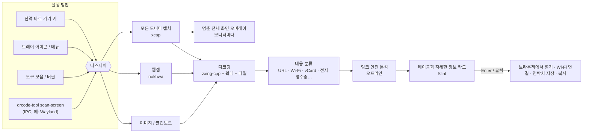

# QRcode tool


 · [English](../../README.md) · [繁體中文](README.zh-TW.md) · [简体中文](README.zh-CN.md) · [Español](README.es.md) · [Português (Brasil)](README.pt-BR.md) · [日本語](README.ja.md) · **한국어** · [Français](README.fr.md) · [Deutsch](README.de.md) · [Русский](README.ru.md) · 

바로 가기 키를 누르면 → 화면의 모든 QR 코드에 레이블이 붙고 → Enter를 누르면 끝.

웹캠으로도 쓸 수 있습니다. 무료, 오픈 소스, 개인정보 보호.

📘 **사용 설명서:** [PDF](../manual/QRcode-tool-User-Manual-ko.pdf) · [Word](../manual/QRcode-tool-User-Manual-ko.docx)


---


## 기능


|                          |                                                                                                                    |
| ------------------------ | ------------------------------------------------------------------------------------------------------------------ |
| ⚡ **간편한 사용**              | Ctrl+Alt+Q를 누르거나 트레이 아이콘을 클릭하면 화면이 멈추고, 빠른 스캔 애니메이션이 모든 코드를 자동으로 찾습니다.                                             |
| 🏷️ **링크 레이블**            | 코드마다 실제 사이트 이름을 보여 줍니다. Enter로 열고, Tab으로 다음 코드로 가고, C로 복사합니다.                                                       |
| ✂️ **영역 선택**              | 코드가 아주 작거나 흐리거나 기울어져 있으면 캡처 도구처럼 사각형으로 둘러싸세요.                                                                     |
| 📷 **웹캠**                 | 인쇄된 코드나 휴대폰 화면을 카메라에 비추면 결과가 실시간으로 나타납니다.                                                                          |
| 🛡️ **링크 안전 검사**          | 링크를 갑자기 열지 않습니다. 비슷한 글자, 위장된 주소(`bank.com@evil.io`), IP 주소, 암호화되지 않은 `http`, 단축 링크 등을 경고하며 모두 오프라인으로 검사합니다.          |
| 📶 **내용 이해**              | Wi-Fi(클릭 한 번으로 연결), 연락처(vCard로 저장), 이메일, 전화, 문자, 지도 위치, 2단계 인증 키, 대만 전자 영수증(두 코드를 합침), 텍스트.                         |
| 🧾 **바코드**                | EAN, UPC, Code 128, Data Matrix, PDF417, Aztec…                                                                    |
| 🖼️ **이미지와 클립보드**         | 복사한 스크린샷이나 이미지 파일을 스캔합니다.                                                                                         |
| 🔳 **간단한 QR 생성기**         | 링크나 텍스트를 QR 코드로 바꿔 복사하거나 PNG/SVG로 저장합니다.                                                                           |
| 🧰 **도구 모음과 버블**          | 깔끔한 플로팅 도구 모음. 위쪽에 한 줄로, 또는 오른쪽·왼쪽 가장자리에 세로로 둘 수 있고, 버블로 접을 수 있으며, 전체 화면 앱에서는 자동으로 숨겨집니다.                         |
| 🎨 **네이티브 모양**            | Windows 스타일로, 밝은/어두운 모드와 강조색을 따릅니다.                                                                                |
| 🌍 **10개 언어**             | English, 繁體中文, 简体中文, Español, Português (Brasil), 日本語, 한국어, Français, Deutsch, Русский.                            |
| 🔒 **개인정보 보호**            | 모든 것이 사용자의 컴퓨터에서 실행됩니다. 계정, 원격 분석, 온라인 링크 조회가 없습니다. 기록은 기본적으로 꺼져 있습니다.                                            |
| ☁️ **가볍고 빠름**             | 네이티브 Rust 코어로 성능은 높이고 메모리 사용은 줄였습니다.                                                                               |


## 미리 보기


|                                                                                                |                                                                                              |
| ---------------------------------------------------------------------------------------------- | -------------------------------------------------------------------------------------------- |
|  의심스러운 링크는 이유를 보여 주고 기다립니다.                |  Wi-Fi 코드는 클릭 한 번으로 연결되고, 암호는 가려집니다.           |
|  클립보드나 이미지 파일을 스캔합니다.                                  |  QR 코드를 만듭니다.                                           |
|  Windows 11 스타일의 설정.                                              |  어두운 모드와 강조색을 따릅니다.                                 |


## 아키텍처




앱은 Cargo 워크스페이스입니다. 작고 테스트하기 쉬운 라이브러리 위에 얇은 UI 크레이트가 올라가 있습니다.
스레드, 데이터 흐름, 설계 결정은 **[docs/ARCHITECTURE.md](../ARCHITECTURE.md)**(영어)를 참고하세요.

**기술 세부 사항**

#### 디코딩 방식

- [zxing-cpp](https://github.com/zxing-cpp/zxing-cpp)가 모니터마다 멈춘 스크린샷을 병렬로 읽습니다.
- 작은 화면은 2배로 확대해서 한 번 더 읽고, 큰 화면은 서로 겹치는 900px 타일로도 나누어 읽으므로 4K 모니터의 작은 코드도 찾아냅니다.
- 영역 선택에서는 여백을 더하고 잘라 낸 부분을 2~3배 확대합니다.
- 웹캠은 별도 스레드에서 최신 프레임을 디코딩하며, 코드가 연속된 세 프레임에서 보여야 결과로 인정합니다.


#### DPI와 여러 모니터

- 화면을 먼저 캡처하고, 각 오버레이는 그 멈춘 그림을 보여 줍니다. 모든 좌표는 스크린샷 픽셀 그대로 두고 UI 안에서 크기를 조정하므로, DPI가 섞인 환경에서도 변환 오류 없이 작동합니다.


#### 링크 안전 규칙

- `http`/`https` 링크만 열 수 있으며, 다른 스킴은 표시만 하고 복사만 할 수 있습니다.
- 셸에는 아무것도 넘기지 않습니다. 링크는 시스템 브라우저 API로 엽니다.
- 경고 항목: 암호화되지 않은 `http`, 사용자 정보 위장(`a.com@b.com`), 국제화 도메인(punycode 표시), 한 레이블 안의 여러 문자 체계, IP 주소, 비정상적인 포트, 단축 링크, 아주 길거나 인코딩이 많은 URL, 깊은 하위 도메인 체인.
- 찾은 코드가 *하나뿐*이고, 경고가 *전혀 없고*, 사이트가 *신뢰 목록*에 있을 때가 아니면 링크를 자동으로 열지 않습니다.
- 단축 링크는 온라인으로 풀지 **않습니다**(그러면 단축 서비스가 무엇을 스캔했는지 알게 됩니다).


#### 플랫폼별 참고


|                   | Windows 10 21H2+ / 11 | macOS 13+          | Linux X11          | Linux Wayland                                 |
| ----------------- | --------------------- | ------------------ | ------------------ | --------------------------------------------- |
| 화면 스캔             | ✅                     | ✅(화면 기록 권한 필요)     | ✅                  | ⚠️ portal / 컴포지터를 통해                          |
| 전역 바로 가기 키        | ✅                     | ✅                  | ✅                  | ➖ 시스템 설정에서 `qrcode-tool scan-screen` 연결         |
| 전체 화면 앱 사용 중 숨기기  | ✅                     | ➖                  | ➖                  | ➖                                             |
| 업데이트              | 앱 내(Velopack)          | 앱 내                | 앱 내(AppImage)      | 앱 내(AppImage)                                 |


#### 민감한 데이터

- 2단계 인증 비밀 값과 Wi-Fi 암호는 기록에 쓰이지 않고 자동으로 복사되지도 않습니다.
- 로그에는 이벤트와 오류만 남으며, 스캔한 내용은 남지 않습니다.


## 설치


### Windows 10(21H2 이상) / 11 — x64 및 ARM64

1. [최신 릴리스](https://github.com/naritaroad/qrcode-tool/releases/latest)에서 `QRcodeTool-win-x64-Setup.exe`(또는 `…-arm64-…`)를 다운로드합니다.
2. 실행합니다. QRcode tool은 현재 사용자에게만 설치되며(관리자 권한 불필요) 트레이에서 시작됩니다.
3. Ctrl+Alt+Q를 눌러 스캔합니다(다른 앱이 이미 쓰고 있으면 *설정 › 바로 가기 키*에서 바꾸세요). 바탕 화면이나 그림을 마우스 오른쪽 단추로 클릭해도 같은 기능을 쓸 수 있습니다(*설정 › 일반 › 오른쪽 클릭 메뉴*). Windows 11에서는 **더 많은 옵션 표시**를 여세요.

> **“Windows의 PC 보호”가 나타나나요?** 초기 릴리스는 아직 코드 서명이 되어 있지 않아 SmartScreen이 알 수 없는 게시자라고 경고할 수 있습니다. **추가 정보 → 실행**을 클릭하세요. 릴리스마다 공개되는 SHA-256 체크섬으로 다운로드를 검증할 수 있습니다. [FAQ](../FAQ.md#windows-smartscreen)(영어)를 참고하세요.

**휴대용** `.zip`도 있습니다(설치 프로그램과 자동 업데이트 없음).

### macOS 13 이상(Apple 실리콘 및 Intel)

[최신 릴리스](https://github.com/naritaroad/qrcode-tool/releases/latest)에서 `.pkg`를 다운로드합니다. 처음 스캔할 때 *시스템 설정 › 개인정보 보호 및 보안*에서 **화면 기록**(웹캠 스캔에는 **카메라**도)을 허용하세요. 릴리스가 아직 공증되지 않았으므로 처음에는 앱을 마우스 오른쪽 단추로 클릭하고 **열기**를 선택하세요.

### Linux

`.AppImage`를 다운로드해 실행 권한을 주고 실행합니다. Wayland에서는 데스크톱 설정에 `qrcode-tool scan-screen`을 실행하는 키보드 바로 가기를 추가하세요.

### 소스에서 빌드

```bash
git clone https://github.com/naritaroad/qrcode-tool
cd qrcode-tool
cargo run --release
```

Rust 1.85 이상, CMake, C++ 컴파일러(zxing-cpp용)가 필요합니다. 플랫폼별 자세한 내용은 **[docs/BUILDING.md](../BUILDING.md)**(영어)를 참고하세요.

### 명령줄

```text
qrcode-tool                     시작(이미 실행 중이면 도구 모음 표시)
qrcode-tool scan-screen         화면 스캔
qrcode-tool scan-region         화면을 멈추고 사각형 그리기
qrcode-tool scan-camera         웹캠으로 스캔
qrcode-tool scan-clipboard      클립보드의 그림 스캔
qrcode-tool scan-file 파일      이미지 파일 하나 스캔
qrcode-tool show-toolbar        플로팅 도구 모음 표시
qrcode-tool generate "텍스트"   QR 코드 만들기
qrcode-tool decode 파일… [--json]   UI 없이 이미지 디코딩
```


## 프로젝트 구조

```text
qrcode-tool/
├─ app/                    # 데스크톱 앱(Slint UI + 연결 코드)
│  ├─ src/                 #   트레이, 바로 가기 키, 오버레이, 미리 보기, 설정, 업데이트…
│  ├─ ui/                  #   .slint 창, 위젯, 아이콘
│  └─ translations/        #   9개 언어의 .po 파일
├─ crates/
│  ├─ qrtool-core/         # 내용 해석, 링크 안전, 설정, 기록(순수 Rust)
│  ├─ qrtool-decode/       # zxing-cpp 디코딩 방식 + QR 생성
│  ├─ qrtool-capture/      # 여러 모니터 스크린샷(xcap)
│  ├─ qrtool-camera/       # 웹캠 캡처 + 실시간 디코딩(nokhwa)
│  └─ qrtool-platform/     # OS 통합: 열기, 자동 시작, 테마, Wi-Fi, IPC, 클립보드, 오른쪽 클릭 메뉴
├─ assets/icons/           # 앱 및 트레이 아이콘
├─ packaging/              # MSIX, Linux 데스크톱 항목, macOS 번들 정보
├─ docs/                   # 아키텍처, 빌드, FAQ, 개인정보, 번역
│  └─ manual/              #   사용 설명서(PDF + Word, 10개 언어)와 빌드 스크립트
└─ .github/workflows/      # CI 및 릴리스 파이프라인
```


## 기여하기

버그 신고, 번역, 코드, 아이디어 등 모든 기여를 환영합니다.

- 먼저 [**CONTRIBUTING.md**](../../CONTRIBUTING.md)를 읽어 주세요.
- 번역 개선: **[docs/TRANSLATING.md](../TRANSLATING.md)**(현재 번역은 기계 번역을 검토한 것이며, 원어민의 도움을 크게 환영합니다).
- 보안 문제를 발견했다면 공개 issue 대신 [**SECURITY.md**](../../SECURITY.md)의 절차를 따라 주세요.
- 모든 참여자는 [**행동 강령**](../../CODE_OF_CONDUCT.md)을 지켜야 합니다.

QRcode tool이 시간을 아껴 주었다면 [프로젝트를 후원](https://github.com/sponsors/naritaroad)해 주세요. ❤️

## 라이선스

다음 라이선스 중 하나를 선택해 사용할 수 있습니다.

- Apache License, Version 2.0([LICENSE-APACHE](../../LICENSE-APACHE))
- MIT license([LICENSE-MIT](../../LICENSE-MIT))

명시적으로 달리 밝히지 않는 한, 이 프로젝트에 포함하도록 제출한 모든 기여는 추가 조건 없이 위의 이중 라이선스로 제공됩니다.

서드파티 구성 요소와 라이선스는 [THIRD_PARTY_NOTICES.md](../../THIRD_PARTY_NOTICES.md)에 나와 있습니다. UI는 [Slint](https://slint.dev)로 만들었으며 Slint Royalty-free Desktop License를 따릅니다.

### 관련 프로젝트

QRcode tool은 다음 프로젝트에서 영감을 받았습니다. 코드는 복사하지 않았습니다. 데스크톱 QR 스캔이 어떤 모습일 수 있는지 보여 주어 고맙습니다.

- [qrpeek](https://github.com/dzoffice/qrpeek) — 화면 QR 코드 인식 도구
- [ScreenQRScanner](https://github.com/Konyaco/ScreenQRScanner) — 화면 QR 코드 스캐너
- [QR-Code-Reader](https://github.com/ottozumkeller/QR-Code-Reader) — 캡처 도구와 ZXing.Net 기반 리더
- [NormCap](https://github.com/dynobo/normcap) — OCR 기반 화면 캡처
- [ShareX](https://github.com/ShareX/ShareX) — QR 코드 도구가 포함된 화면 캡처 도구 모음
- [CodeTwo QR Code Desktop Reader](https://www.codetwo.com/freeware/qr-code-desktop-reader/) — 무료 데스크톱 리더

[zxing-cpp](https://github.com/zxing-cpp/zxing-cpp), [Slint](https://github.com/slint-ui/slint), [xcap](https://github.com/nashaofu/xcap), [nokhwa](https://github.com/l1npengtul/nokhwa), [global-hotkey](https://github.com/tauri-apps/global-hotkey), [Velopack](https://github.com/velopack/velopack), [qrcode](https://github.com/kennytm/qrcode-rust) 위에 만들어졌습니다.

---

QR Code는 DENSO WAVE INCORPORATED의 등록 상표입니다. QRcode tool은 DENSO WAVE, Google, Microsoft와 관련이 없습니다.
