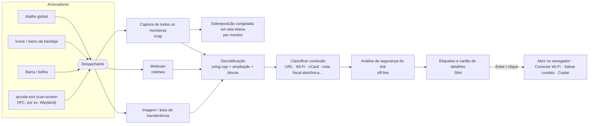

# QRcode tool


 · [English](../../README.md) · [繁體中文](README.zh-TW.md) · [简体中文](README.zh-CN.md) · [Español](README.es.md) · **Português (Brasil)** · [日本語](README.ja.md) · [한국어](README.ko.md) · [Français](README.fr.md) · [Deutsch](README.de.md) · [Русский](README.ru.md) · 

Pressione um atalho → cada código QR na tela ganha uma etiqueta → pressione Enter.

Funciona também com a webcam. Gratuito, de código aberto e privado.

📘 **Manual do usuário:** [PDF](../manual/QRcode-tool-User-Manual-pt-BR.pdf) · [Word](../manual/QRcode-tool-User-Manual-pt-BR.docx)


---


## Recursos


|                                     |                                                                                                                                                                             |
| ----------------------------------- | --------------------------------------------------------------------------------------------------------------------------------------------------------------------------- |
| ⚡ **Fácil de usar**                  | Pressione Ctrl+Alt+Q, ou clique no ícone da bandeja, para congelar a tela. Uma varredura rápida encontra todos os códigos automaticamente.                                   |
| 🏷️ **Etiquetas de link**            | Cada código mostra o nome real do site. Enter abre, Tab passa para o próximo e C copia.                                                                                     |
| ✂️ **Selecionar uma área**           | Quando um código é minúsculo, borrado ou inclinado, arraste um retângulo em volta dele, como na Ferramenta de Captura.                                                       |
| 📷 **Webcam**                        | Mostre à câmera um código impresso ou a tela de um celular; os resultados aparecem ao vivo.                                                                                 |
| 🛡️ **Segurança de links**           | Nunca abre um link de surpresa. Avisa sobre letras parecidas, endereços disfarçados (`bank.com@evil.io`), endereços IP, `http` sem criptografia, links encurtados e mais — tudo off-line. |
| 📶 **Entende o conteúdo**            | Wi-Fi (conexão com um clique), contatos (salvos como vCard), email, telefone, SMS, locais no mapa, chaves de verificação em duas etapas, notas fiscais eletrônicas de Taiwan (os dois códigos são unidos) e texto. |
| 🧾 **Códigos de barras**             | EAN, UPC, Code 128, Data Matrix, PDF417, Aztec…                                                                                                                             |
| 🖼️ **Imagens e área de transferência** | Escaneie uma captura de tela copiada ou qualquer arquivo de imagem.                                                                                                      |
| 🔳 **Gerador de QR simples**         | Transforme um link ou texto em código QR; copie ou salve como PNG/SVG.                                                                                                      |
| 🧰 **Barra e bolha**                 | Uma barra flutuante limpa — uma linha no topo ou uma coluna na borda direita ou esquerda — que se recolhe em uma bolha e se esconde sozinha em aplicativos de tela inteira. |
| 🎨 **Visual nativo**                 | Estilo do Windows; segue o modo claro/escuro e a sua cor de destaque.                                                                                                       |
| 🌍 **10 idiomas**                    | English, 繁體中文, 简体中文, Español, Português (Brasil), 日本語, 한국어, Français, Deutsch, Русский.                                                                                     |
| 🔒 **Privado**                       | Tudo roda no seu computador. Sem conta, sem telemetria, sem verificação de links on-line. O histórico vem desativado.                                                       |
| ☁️ **Leve e rápido**                 | Um núcleo nativo em Rust, com mais desempenho e menos uso de memória.                                                                                                       |


## Demonstração


|                                                                                                                                       |                                                                                                                                     |
| ------------------------------------------------------------------------------------------------------------------------------------- | ----------------------------------------------------------------------------------------------------------------------------------- |
|  Links suspeitos mostram o motivo — e esperam por você.    |  Códigos Wi-Fi conectam com um clique; a senha fica oculta.          |
|  Escaneie a área de transferência ou um arquivo de imagem. |  Crie um código QR.                                                                   |
|  Configurações no estilo do Windows 11.                                                       |  Segue o modo escuro e a sua cor de destaque.                                        |


## Arquitetura




O aplicativo é um workspace do Cargo: um crate de interface fino sobre bibliotecas pequenas e fáceis de testar.
Veja **[docs/ARCHITECTURE.md](../ARCHITECTURE.md)** (em inglês) para threads, fluxo de dados e decisões de design.

**Detalhes técnicos**

#### Estratégia de decodificação

- O [zxing-cpp](https://github.com/zxing-cpp/zxing-cpp) lê em paralelo a captura congelada de cada monitor.
- Telas pequenas também são lidas em escala 2×; telas grandes são divididas ainda em blocos sobrepostos de 900 px, então um código pequeno em um monitor 4K continua sendo encontrado.
- A seleção de área adiciona uma margem em branco e amplia o recorte de 2 a 3 vezes.
- A webcam decodifica o quadro mais recente em sua própria thread, e um código precisa aparecer em três quadros seguidos para valer.


#### DPI e vários monitores

- A tela é capturada primeiro e cada sobreposição mostra essa imagem congelada. Todas as coordenadas ficam em pixels da captura e são escaladas dentro da interface, então configurações com DPI misto funcionam sem erros de conversão.


#### Regras de segurança de links

- Só links `http`/`https` podem ser abertos; qualquer outro esquema é exibido e só pode ser copiado.
- Nada é passado a um shell. Os links abrem pela API de navegador do sistema.
- Avisos: `http` sem criptografia, disfarce com informações de usuário (`a.com@b.com`), domínios internacionais (mostra o punycode), alfabetos misturados em um mesmo rótulo, endereços IP, portas incomuns, links encurtados, URLs muito longas ou muito codificadas e cadeias profundas de subdomínios.
- Links nunca abrem automaticamente, a não ser que sejam o *único* código encontrado, não tenham *nenhum* aviso e o site esteja na sua *lista de confiáveis*.
- Links encurtados **não** são expandidos on-line (isso diria ao encurtador o que você escaneou).


#### Observações por plataforma


|                                      | Windows 10 21H2+ / 11 | macOS 13+                              | Linux X11         | Linux Wayland                                                   |
| ------------------------------------ | --------------------- | -------------------------------------- | ----------------- | --------------------------------------------------------------- |
| Leitura da tela                      | ✅                     | ✅ (permissão de Gravação de Tela)       | ✅                 | ⚠️ via portal / compositor                                      |
| Atalho global                        | ✅                     | ✅                                      | ✅                 | ➖ associe `qrcode-tool scan-screen` nas configurações do sistema |
| Ocultar em apps de tela inteira      | ✅                     | ➖                                      | ➖                 | ➖                                                               |
| Atualizações                         | no app (Velopack)     | no app                                 | no app (AppImage) | no app (AppImage)                                               |


#### Dados sensíveis

- Segredos de verificação em duas etapas e senhas de Wi-Fi nunca são gravados no histórico nem copiados automaticamente.
- Os logs contêm só eventos e erros, nunca conteúdo escaneado.


## Instalação


### Windows 10 (21H2+) / 11 — x64 e ARM64

1. Baixe `QRcodeTool-win-x64-Setup.exe` (ou `…-arm64-…`) da [versão mais recente](https://github.com/naritaroad/qrcode-tool/releases/latest).
2. Execute. O QRcode tool é instalado só para o seu usuário (sem direitos de administrador) e inicia na bandeja.
3. Pressione Ctrl+Alt+Q para escanear (altere em *Configurações › Atalhos* se outro aplicativo já usar essa combinação). Clique com o botão direito na área de trabalho ou em uma imagem para usar as mesmas ferramentas (*Configurações › Geral › Menu do botão direito*). No Windows 11, abra **Mostrar mais opções**.

> **“O Windows protegeu o computador”?** As primeiras versões ainda não têm assinatura de código, então o SmartScreen pode avisar sobre um editor desconhecido. Clique em **Mais informações → Executar assim mesmo**. Você pode conferir o download com as somas SHA-256 publicadas em cada versão. Veja as [perguntas frequentes](../FAQ.md#windows-smartscreen) (em inglês).

Também há um `.zip` **portátil** (sem instalador e sem atualizações automáticas).

### macOS 13+ (Apple silicon e Intel)

Baixe o `.pkg` da [versão mais recente](https://github.com/naritaroad/qrcode-tool/releases/latest). Na primeira leitura, permita **Gravação de Tela** (e **Câmera** para usar a webcam) em *Ajustes do Sistema › Privacidade e Segurança*. As versões ainda não são autenticadas: na primeira vez, clique com o botão direito no app e escolha **Abrir**.

### Linux

Baixe o `.AppImage`, torne-o executável e execute. No Wayland, adicione nas configurações da área de trabalho um atalho de teclado que execute `qrcode-tool scan-screen`.

### Compilar a partir do código-fonte

```bash
git clone https://github.com/naritaroad/qrcode-tool
cd qrcode-tool
cargo run --release
```

Você precisa de Rust 1.85+, CMake e um compilador C++ (para o zxing-cpp). Detalhes de cada plataforma: **[docs/BUILDING.md](../BUILDING.md)** (em inglês).

### Linha de comando

```text
qrcode-tool                     iniciar (ou mostrar a barra se já estiver em execução)
qrcode-tool scan-screen         escanear a tela
qrcode-tool scan-region         congelar a tela e arrastar um retângulo
qrcode-tool scan-camera         escanear com a webcam
qrcode-tool scan-clipboard      escanear a imagem da área de transferência
qrcode-tool scan-file ARQUIVO   escanear um arquivo de imagem
qrcode-tool show-toolbar        mostrar a barra de ferramentas flutuante
qrcode-tool generate "TEXTO"    criar um código QR
qrcode-tool decode ARQUIVO… [--json]   decodificar imagens sem a interface
```


## Estrutura do projeto

```text
qrcode-tool/
├─ app/                    # O aplicativo de desktop (interface Slint + código de ligação)
│  ├─ src/                 #   bandeja, atalhos, sobreposição, visualização, configurações, atualizador…
│  ├─ ui/                  #   janelas .slint, widgets, ícones
│  └─ translations/        #   arquivos .po de 9 idiomas
├─ crates/
│  ├─ qrtool-core/         # Análise de conteúdo, segurança de links, configurações, histórico (Rust puro)
│  ├─ qrtool-decode/       # Estratégia de decodificação com zxing-cpp + geração de QR
│  ├─ qrtool-capture/      # Capturas de vários monitores (xcap)
│  ├─ qrtool-camera/       # Captura da webcam + decodificação ao vivo (nokhwa)
│  └─ qrtool-platform/     # Integração com o sistema: abrir, inicialização, tema, Wi-Fi, IPC, área de transferência, menu de contexto
├─ assets/icons/           # Ícones do aplicativo e da bandeja
├─ packaging/              # MSIX, entrada de desktop do Linux, informações do pacote macOS
├─ docs/                   # Arquitetura, compilação, perguntas frequentes, privacidade, traduções
│  └─ manual/              #   Manual do usuário (PDF + Word, 10 idiomas) e scripts de geração
└─ .github/workflows/      # CI e pipeline de publicação
```


## Contribuir

Contribuições são bem-vindas — relatos de bugs, traduções, código e ideias.

- Leia **[CONTRIBUTING.md](../../CONTRIBUTING.md)** para começar.
- Melhore uma tradução: **[docs/TRANSLATING.md](../TRANSLATING.md)** (as traduções atuais são traduções automáticas revisadas; falantes nativos são muito bem-vindos).
- Encontrou um problema de segurança? Siga o **[SECURITY.md](../../SECURITY.md)** em vez de abrir uma issue pública.
- Todas as pessoas participantes devem seguir o **[Código de Conduta](../../CODE_OF_CONDUCT.md)**.

Se o QRcode tool economiza seu tempo, você pode [patrocinar o projeto](https://github.com/sponsors/naritaroad). ❤️

## Licença

Licenciado, à sua escolha, sob uma destas licenças:

- Apache License, Version 2.0 ([LICENSE-APACHE](../../LICENSE-APACHE))
- MIT license ([LICENSE-MIT](../../LICENSE-MIT))

Salvo declaração expressa em contrário, qualquer contribuição enviada para inclusão neste projeto terá o licenciamento duplo acima, sem termos ou condições adicionais.

Os componentes de terceiros e suas licenças estão listados em [THIRD_PARTY_NOTICES.md](../../THIRD_PARTY_NOTICES.md). A interface é feita com [Slint](https://slint.dev) sob a Slint Royalty-free Desktop License.

### Projetos relacionados

O QRcode tool foi inspirado por estes projetos. Nenhum código foi copiado deles; obrigado por mostrarem o que a leitura de QR no desktop pode ser:

- [qrpeek](https://github.com/dzoffice/qrpeek) — ferramenta de reconhecimento de códigos QR na tela
- [ScreenQRScanner](https://github.com/Konyaco/ScreenQRScanner) — leitor de códigos QR na tela
- [QR-Code-Reader](https://github.com/ottozumkeller/QR-Code-Reader) — leitor baseado na Ferramenta de Captura e no ZXing.Net
- [NormCap](https://github.com/dynobo/normcap) — captura de tela com OCR
- [ShareX](https://github.com/ShareX/ShareX) — suíte de captura de tela com ferramenta de QR code
- [CodeTwo QR Code Desktop Reader](https://www.codetwo.com/freeware/qr-code-desktop-reader/) — leitor de desktop gratuito

Construído sobre [zxing-cpp](https://github.com/zxing-cpp/zxing-cpp), [Slint](https://github.com/slint-ui/slint), [xcap](https://github.com/nashaofu/xcap), [nokhwa](https://github.com/l1npengtul/nokhwa), [global-hotkey](https://github.com/tauri-apps/global-hotkey), [Velopack](https://github.com/velopack/velopack) e [qrcode](https://github.com/kennytm/qrcode-rust).

---

QR Code é uma marca registrada da DENSO WAVE INCORPORATED. O QRcode tool não é afiliado à DENSO WAVE, ao Google nem à Microsoft.
