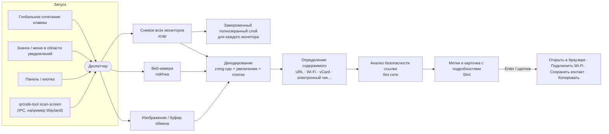

# QRcode tool


 · [English](../../README.md) · [繁體中文](README.zh-TW.md) · [简体中文](README.zh-CN.md) · [Español](README.es.md) · [Português (Brasil)](README.pt-BR.md) · [日本語](README.ja.md) · [한국어](README.ko.md) · [Français](README.fr.md) · [Deutsch](README.de.md) · **Русский** · 

Нажмите сочетание клавиш → каждый QR-код на экране получит метку → нажмите Enter.

Работает и с веб-камерой. Бесплатно, с открытым исходным кодом и без слежки.

📘 **Руководство пользователя:** [PDF](../manual/QRcode-tool-User-Manual-ru.pdf) · [Word](../manual/QRcode-tool-User-Manual-ru.docx)


---


## Возможности


|                                         |                                                                                                                                                                         |
| --------------------------------------- | ----------------------------------------------------------------------------------------------------------------------------------------------------------------------- |
| ⚡ **Просто пользоваться**                | Нажмите Ctrl+Alt+Q или щёлкните значок в области уведомлений, чтобы заморозить экран. Быстрая анимация сканирования автоматически находит все коды.                       |
| 🏷️ **Метки ссылок**                     | На каждом коде показано настоящее имя сайта. Enter открывает, Tab переходит к следующему, C копирует.                                                                     |
| ✂️ **Выделить область**                  | Если код крошечный, размытый или наклонённый, обведите его рамкой, как в «Ножницах».                                                                                    |
| 📷 **Веб-камера**                        | Поднесите к камере напечатанный код или экран телефона — результаты появляются сразу.                                                                                    |
| 🛡️ **Безопасность ссылок**              | Никогда не открывает ссылку неожиданно. Предупреждает о похожих буквах, замаскированных адресах (`bank.com@evil.io`), IP-адресах, `http` без шифрования, коротких ссылках и многом другом — всё без подключения к сети. |
| 📶 **Понимает содержимое**               | Wi-Fi (подключение одним щелчком), контакты (сохраняются как vCard), почта, телефон, SMS, места на карте, ключи двухэтапной проверки, тайваньские электронные чеки (два кода объединяются) и текст. |
| 🧾 **Штрихкоды**                         | EAN, UPC, Code 128, Data Matrix, PDF417, Aztec…                                                                                                                         |
| 🖼️ **Изображения и буфер обмена**       | Сканируйте скопированный снимок экрана или любой файл изображения.                                                                                                      |
| 🔳 **Простой генератор QR**              | Превратите ссылку или текст в QR-код; скопируйте его или сохраните в PNG/SVG.                                                                                           |
| 🧰 **Панель и кнопка**                   | Аккуратная плавающая панель — строкой вверху или колонкой у правого либо левого края, — которая сворачивается в кнопку и сама прячется при полноэкранных приложениях.     |
| 🎨 **Родной вид**                        | Стиль Windows, следует светлому/тёмному режиму и вашему цвету акцента.                                                                                                  |
| 🌍 **10 языков**                         | English, 繁體中文, 简体中文, Español, Português (Brasil), 日本語, 한국어, Français, Deutsch, Русский.                                                                                 |
| 🔒 **Конфиденциально**                   | Всё работает на вашем компьютере. Без учётной записи, без телеметрии, без онлайн-проверки ссылок. Журнал по умолчанию выключен.                                          |
| ☁️ **Лёгкий и быстрый**                  | Нативное ядро на Rust: выше производительность и меньше расход памяти.                                                                                                  |


## Демонстрация


|                                                                                                                                 |                                                                                                                                     |
| ------------------------------------------------------------------------------------------------------------------------------- | ----------------------------------------------------------------------------------------------------------------------------------- |
|  Подозрительные ссылки объясняют причину — и ждут вас. |  Коды Wi-Fi подключаются одним щелчком; пароль остаётся скрытым.       |
|  Сканируйте буфер обмена или файл изображения.            |  Создайте QR-код.                                                                       |
|  Параметры в стиле Windows 11.                                                              |  Следует тёмному режиму и вашему цвету акцента.                                     |


## Архитектура




Приложение — это рабочая область Cargo: тонкий крейт интерфейса поверх небольших, легко тестируемых библиотек.
О потоках, движении данных и проектных решениях рассказано в **[docs/ARCHITECTURE.md](../ARCHITECTURE.md)** (на английском).

**Технические подробности**

#### Стратегия декодирования

- [zxing-cpp](https://github.com/zxing-cpp/zxing-cpp) параллельно считывает замороженный снимок каждого монитора.
- Маленькие экраны дополнительно читаются с увеличением в 2 раза; большие ещё и делятся на перекрывающиеся плитки по 900 px, поэтому даже мелкий код на мониторе 4K находится.
- При выделении области добавляется пустое поле, а фрагмент увеличивается в 2–3 раза.
- Веб-камера декодирует самый свежий кадр в отдельном потоке, и код засчитывается, только если его видно в трёх кадрах подряд.


#### DPI и несколько мониторов

- Сначала делается снимок экрана, и каждый слой показывает это замороженное изображение. Все координаты остаются в пикселях снимка и масштабируются в интерфейсе, поэтому конфигурации со смешанным DPI работают без ошибок пересчёта.


#### Правила безопасности ссылок

- Открывать можно только ссылки `http`/`https`; любая другая схема показывается и может быть только скопирована.
- Ничего не передаётся в оболочку. Ссылки открываются через системный API браузера.
- Предупреждения: `http` без шифрования, маскировка с помощью данных пользователя (`a.com@b.com`), международные домены (показывается punycode), смешение алфавитов в одной части имени, IP-адреса, необычные порты, короткие ссылки, очень длинные или сильно закодированные URL, глубокие цепочки поддоменов.
- Ссылки никогда не открываются автоматически, если только это не *единственный* найденный код, у него *нет* предупреждений и сайт есть в вашем *списке надёжных*.
- Короткие ссылки **не** раскрываются через интернет (иначе сервис коротких ссылок узнал бы, что вы отсканировали).


#### Особенности платформ


|                                       | Windows 10 21H2+ / 11 | macOS 13+                                | Linux X11                | Linux Wayland                                                    |
| ------------------------------------- | --------------------- | ---------------------------------------- | ------------------------ | ---------------------------------------------------------------- |
| Сканирование экрана                   | ✅                     | ✅ (нужно разрешение «Запись экрана»)      | ✅                        | ⚠️ через portal / композитор                                     |
| Глобальное сочетание клавиш           | ✅                     | ✅                                        | ✅                        | ➖ назначьте `qrcode-tool scan-screen` в настройках системы       |
| Скрытие при полноэкранных приложениях | ✅                     | ➖                                        | ➖                        | ➖                                                                |
| Обновления                            | в приложении (Velopack) | в приложении                           | в приложении (AppImage)  | в приложении (AppImage)                                          |


#### Конфиденциальные данные

- Секреты двухэтапной проверки и пароли Wi-Fi никогда не записываются в журнал и не копируются автоматически.
- В журналы работы попадают только события и ошибки, никогда — отсканированное содержимое.


## Установка


### Windows 10 (21H2+) / 11 — x64 и ARM64

1. Скачайте `QRcodeTool-win-x64-Setup.exe` (или `…-arm64-…`) со страницы [последней версии](https://github.com/naritaroad/qrcode-tool/releases/latest).
2. Запустите его. QRcode tool устанавливается только для вашего пользователя (без прав администратора) и запускается в области уведомлений.
3. Нажмите Ctrl+Alt+Q, чтобы сканировать (если сочетание уже занято другим приложением, измените его в *Параметры › Сочетания клавиш*). Те же функции доступны по щелчку правой кнопкой на рабочем столе или изображении (*Параметры › Общие › Контекстное меню*). В Windows 11 откройте **Показать дополнительные параметры**.

> **«Система Windows защитила ваш компьютер»?** Первые выпуски пока не подписаны, поэтому SmartScreen может предупредить о неизвестном издателе. Нажмите **Подробнее → Выполнить в любом случае**. Загрузку можно проверить по контрольным суммам SHA-256, которые публикуются с каждым выпуском. См. [FAQ](../FAQ.md#windows-smartscreen) (на английском).

Есть и **переносная** версия в `.zip` (без установщика и без автоматических обновлений).

### macOS 13+ (Apple Silicon и Intel)

Скачайте `.pkg` со страницы [последней версии](https://github.com/naritaroad/qrcode-tool/releases/latest). При первом сканировании разрешите **Запись экрана** (и **Камера** для сканирования веб-камерой) в *Системные настройки › Конфиденциальность и безопасность*. Выпуски пока не заверены Apple — в первый раз щёлкните приложение правой кнопкой мыши и выберите **Открыть**.

### Linux

Скачайте `.AppImage`, сделайте его исполняемым и запустите. В Wayland добавьте в настройках рабочего стола сочетание клавиш, которое выполняет `qrcode-tool scan-screen`.

### Сборка из исходного кода

```bash
git clone https://github.com/naritaroad/qrcode-tool
cd qrcode-tool
cargo run --release
```

Нужны Rust 1.85+, CMake и компилятор C++ (для zxing-cpp). Подробности для каждой платформы: **[docs/BUILDING.md](../BUILDING.md)** (на английском).

### Командная строка

```text
qrcode-tool                     запустить (или показать панель, если уже запущено)
qrcode-tool scan-screen         сканировать экран
qrcode-tool scan-region         заморозить экран и обвести рамку
qrcode-tool scan-camera         сканировать веб-камерой
qrcode-tool scan-clipboard      сканировать изображение из буфера обмена
qrcode-tool scan-file ФАЙЛ      сканировать один файл изображения
qrcode-tool show-toolbar        показать плавающую панель инструментов
qrcode-tool generate "ТЕКСТ"    создать QR-код
qrcode-tool decode ФАЙЛ… [--json]   декодировать изображения без интерфейса
```


## Структура проекта

```text
qrcode-tool/
├─ app/                    # Настольное приложение (интерфейс Slint + связующий код)
│  ├─ src/                 #   область уведомлений, сочетания клавиш, слой, просмотр, параметры, обновление…
│  ├─ ui/                  #   окна .slint, виджеты, значки
│  └─ translations/        #   файлы .po для 9 языков
├─ crates/
│  ├─ qrtool-core/         # Разбор содержимого, безопасность ссылок, параметры, журнал (чистый Rust)
│  ├─ qrtool-decode/       # Стратегия декодирования zxing-cpp + создание QR
│  ├─ qrtool-capture/      # Снимки нескольких мониторов (xcap)
│  ├─ qrtool-camera/       # Захват с веб-камеры + декодирование на лету (nokhwa)
│  └─ qrtool-platform/     # Интеграция с ОС: открытие, автозапуск, тема, Wi-Fi, IPC, буфер обмена, контекстное меню
├─ assets/icons/           # Значки приложения и области уведомлений
├─ packaging/              # MSIX, ярлык рабочего стола Linux, сведения пакета macOS
├─ docs/                   # Архитектура, сборка, FAQ, конфиденциальность, переводы
│  └─ manual/              #   Руководство пользователя (PDF + Word, 10 языков) и скрипты его сборки
└─ .github/workflows/      # CI и конвейер выпуска
```


## Участие в проекте

Мы рады любому вкладу — сообщениям об ошибках, переводам, коду и идеям.

- Для начала прочитайте **[CONTRIBUTING.md](../../CONTRIBUTING.md)**.
- Улучшить перевод: **[docs/TRANSLATING.md](../TRANSLATING.md)** (текущие переводы — проверенный машинный перевод; помощь носителей языка очень приветствуется).
- Нашли проблему безопасности? Следуйте **[SECURITY.md](../../SECURITY.md)**, а не открывайте публичный issue.
- Все участники должны соблюдать **[Кодекс поведения](../../CODE_OF_CONDUCT.md)**.

Если QRcode tool экономит вам время, вы можете [поддержать проект](https://github.com/sponsors/naritaroad). ❤️

## Лицензия

Распространяется на ваш выбор по одной из лицензий:

- Apache License, Version 2.0 ([LICENSE-APACHE](../../LICENSE-APACHE))
- MIT license ([LICENSE-MIT](../../LICENSE-MIT))

Если вы явно не укажете иное, любой вклад, который вы отправляете для включения в этот проект, распространяется по указанной двойной лицензии без каких-либо дополнительных условий.

Сторонние компоненты и их лицензии перечислены в [THIRD_PARTY_NOTICES.md](../../THIRD_PARTY_NOTICES.md). Интерфейс создан на [Slint](https://slint.dev) по лицензии Slint Royalty-free Desktop License.

### Похожие проекты

QRcode tool вдохновлён этими проектами. Код из них не копировался; спасибо им за то, что показали, каким может быть сканирование QR-кодов на компьютере:

- [qrpeek](https://github.com/dzoffice/qrpeek) — распознавание QR-кодов на экране
- [ScreenQRScanner](https://github.com/Konyaco/ScreenQRScanner) — сканер QR-кодов на экране
- [QR-Code-Reader](https://github.com/ottozumkeller/QR-Code-Reader) — считыватель на основе «Ножниц» и ZXing.Net
- [NormCap](https://github.com/dynobo/normcap) — захват экрана с OCR
- [ShareX](https://github.com/ShareX/ShareX) — набор для снимков экрана с инструментом для QR-кодов
- [CodeTwo QR Code Desktop Reader](https://www.codetwo.com/freeware/qr-code-desktop-reader/) — бесплатный настольный считыватель

Построено на [zxing-cpp](https://github.com/zxing-cpp/zxing-cpp), [Slint](https://github.com/slint-ui/slint), [xcap](https://github.com/nashaofu/xcap), [nokhwa](https://github.com/l1npengtul/nokhwa), [global-hotkey](https://github.com/tauri-apps/global-hotkey), [Velopack](https://github.com/velopack/velopack) и [qrcode](https://github.com/kennytm/qrcode-rust).

---

QR Code — зарегистрированный товарный знак DENSO WAVE INCORPORATED. QRcode tool не связан с DENSO WAVE, Google или Microsoft.
