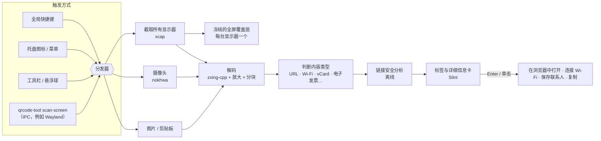

# QRcode tool


 · [English](../../README.md) · [繁體中文](README.zh-TW.md) · **简体中文** · [Español](README.es.md) · [Português (Brasil)](README.pt-BR.md) · [日本語](README.ja.md) · [한국어](README.ko.md) · [Français](README.fr.md) · [Deutsch](README.de.md) · [Русский](README.ru.md) · 

按一下快捷键 → 屏幕上的每个二维码都会出现标签 → 按 Enter 打开。

也能用摄像头扫描。免费、开源、不收集任何数据。

📘 **用户手册：**[PDF](../manual/QRcode-tool-User-Manual-zh-CN.pdf) · [Word](../manual/QRcode-tool-User-Manual-zh-CN.docx)


---


## 功能特点


|                     |                                                                                                       |
| ------------------- | ----------------------------------------------------------------------------------------------------- |
| ⚡ **简单易用**          | 按 Ctrl+Alt+Q 或单击托盘图标即可冻结屏幕，快速扫描动画会自动找出所有码。                                                           |
| 🏷️ **链接标签**        | 每个码上都显示真实的网站名称。Enter 打开，Tab 切换到下一个，C 复制。                                                              |
| ✂️ **框选区域**         | 码太小、模糊或倾斜时，像截图工具一样拖出一个方框即可。                                                                          |
| 📷 **摄像头**          | 把印刷的码或手机屏幕对准摄像头，结果实时显示。                                                                              |
| 🛡️ **链接安全检查**      | 绝不会突然打开链接。会提示形近字母、伪装地址（`bank.com@evil.io`）、IP 地址、未加密的 `http`、短链接等，全部离线完成。                              |
| 📶 **理解内容**         | Wi-Fi（一键连接）、联系人（保存为 vCard）、电子邮件、电话、短信、地图位置、两步验证密钥、台湾电子发票（左右两个码自动合并）和普通文本。                               |
| 🧾 **条形码**          | EAN、UPC、Code 128、Data Matrix、PDF417、Aztec…                                                            |
| 🖼️ **图片与剪贴板**      | 扫描复制的截图或任意图片文件。                                                                                      |
| 🔳 **简易二维码生成器**     | 把链接或文本转换成二维码，可复制或保存为 PNG/SVG。                                                                         |
| 🧰 **工具栏与悬浮球**      | 简洁的悬浮工具栏，可以横放在屏幕顶部，也可以竖放在屏幕右侧或左侧；能收起为悬浮球，全屏应用运行时自动隐藏。                                                  |
| 🎨 **原生外观**         | Windows 风格，跟随浅色/深色模式和系统强调色。                                                                          |
| 🌍 **10 种语言**       | English、繁體中文、简体中文、Español、Português (Brasil)、日本語、한국어、Français、Deutsch、Русский。                         |
| 🔒 **注重隐私**         | 一切都在你的电脑上运行。无需账号，没有遥测，不会在线查询链接。扫描历史默认关闭。                                                              |
| ☁️ **轻巧快速**         | 原生 Rust 核心，性能更高，内存占用更低。                                                                               |


## 界面展示


|                                                                     |                                                                       |
| ------------------------------------------------------------------- | --------------------------------------------------------------------- |
|  可疑链接会说明原因，并等你确认。 |  Wi-Fi 码一键连接，密码默认隐藏。 |
|  扫描剪贴板或图片文件。                  |  生成二维码。                             |
|  Windows 11 风格的设置界面。                      |  跟随深色模式和系统强调色。                |


## 架构




本应用是一个 Cargo 工作区：一个精简的 UI crate，建立在几个小而易测试的库之上。
线程、数据流和设计决策请见 **[docs/ARCHITECTURE.md](../ARCHITECTURE.md)**（英文）。

**技术细节**

#### 解码策略

- 用 [zxing-cpp](https://github.com/zxing-cpp/zxing-cpp) 并行读取每台显示器的冻结截图。
- 小屏幕会再以 2 倍放大读取一次；大屏幕还会切成互相重叠的 900 px 分块，因此 4K 显示器上的小码也能找到。
- 框选区域会加上留白，并把裁剪部分放大 2–3 倍。
- 摄像头在独立线程中解码最新一帧，同一个码要在连续 3 帧中都被读到才算数。


#### DPI 与多显示器

- 先截取屏幕，再让每个覆盖层显示这张冻结的画面。所有坐标都以截图像素表示，并在界面中缩放，因此混合 DPI 的环境也不会出现换算错误。


#### 链接安全规则

- 只能打开 `http`/`https` 链接；其他协议只显示，并且只能复制。
- 不经过 shell，通过系统浏览器 API 打开链接。
- 警告项目：未加密的 `http`、用户信息伪装（`a.com@b.com`）、国际化域名（显示 punycode）、同一段中混用字母表、IP 地址、不常见的端口、短链接、过长或大量编码的 URL、层级很深的子域名。
- 只有当链接是*唯一*找到的码、*没有*任何警告、且网站在你的*受信任列表*中时，才会自动打开。
- 短链接**不会**在线展开（那会让短链接服务知道你扫描了什么）。


#### 平台说明


|              | Windows 10 21H2+ / 11 | macOS 13+   | Linux X11         | Linux Wayland                             |
| ------------ | --------------------- | ----------- | ----------------- | ----------------------------------------- |
| 屏幕扫描         | ✅                     | ✅（需要屏幕录制权限） | ✅                 | ⚠️ 通过 portal / 合成器                        |
| 全局快捷键        | ✅                     | ✅           | ✅                 | ➖ 在系统设置中绑定 `qrcode-tool scan-screen`      |
| 全屏应用时隐藏      | ✅                     | ➖           | ➖                 | ➖                                         |
| 更新           | 应用内（Velopack）         | 应用内         | 应用内（AppImage）     | 应用内（AppImage）                             |


#### 敏感数据

- 两步验证密钥和 Wi-Fi 密码永远不会写入历史记录，也不会被自动复制。
- 日志只记录事件和错误，从不包含扫描内容。


## 安装


### Windows 10（21H2 及以上）/ 11 — x64 与 ARM64

1. 从[最新版本](https://github.com/naritaroad/qrcode-tool/releases/latest)下载 `QRcodeTool-win-x64-Setup.exe`（ARM 电脑请选 `…-arm64-…`）。
2. 运行它。QRcode tool 只安装到你的用户账户下（无需管理员权限），并在托盘中启动。
3. 按 Ctrl+Alt+Q 开始扫描（如果已被其他应用占用，可在“设置 › 快捷键”中修改）。右键单击桌面或图片也能使用同样的功能（“设置 › 常规 › 右键菜单”）。在 Windows 11 上请先选择“显示更多选项”。

> **出现“Windows 已保护你的电脑”？** 早期版本尚未进行代码签名，SmartScreen 可能会提示发布者未知。请单击 **更多信息 → 仍要运行**。每个版本都附有 SHA-256 校验和，可用来核对下载的文件。详见 [FAQ](../FAQ.md#windows-smartscreen)（英文）。

也提供**便携版** `.zip`（无需安装，不会自动更新）。

### macOS 13+（Apple 芯片与 Intel）

从[最新版本](https://github.com/naritaroad/qrcode-tool/releases/latest)下载 `.pkg`。首次扫描时，请在“系统设置 › 隐私与安全性”中允许**屏幕录制**（使用摄像头扫描时还需允许**相机**）。目前版本尚未公证，第一次请右键单击应用并选择**打开**。

### Linux

下载 `.AppImage`，添加执行权限后运行。在 Wayland 下，请在桌面设置中添加一个运行 `qrcode-tool scan-screen` 的键盘快捷键。

### 从源代码构建

```bash
git clone https://github.com/naritaroad/qrcode-tool
cd qrcode-tool
cargo run --release
```

需要 Rust 1.85+、CMake 和 C++ 编译器（用于 zxing-cpp）。各平台的详细说明见 **[docs/BUILDING.md](../BUILDING.md)**（英文）。

### 命令行

```text
qrcode-tool                     启动（已在运行时显示工具栏）
qrcode-tool scan-screen         扫描屏幕
qrcode-tool scan-region         冻结屏幕并框选区域
qrcode-tool scan-camera         用摄像头扫描
qrcode-tool scan-clipboard      扫描剪贴板中的图片
qrcode-tool scan-file 文件      扫描一个图片文件
qrcode-tool show-toolbar        显示悬浮工具栏
qrcode-tool generate "文本"     生成二维码
qrcode-tool decode 文件… [--json]   不打开界面直接解码图片
```


## 项目结构

```text
qrcode-tool/
├─ app/                    # 桌面应用（Slint 界面与胶水代码）
│  ├─ src/                 #   托盘、快捷键、覆盖层、预览、设置、更新…
│  ├─ ui/                  #   .slint 窗口、控件、图标
│  └─ translations/        #   9 种语言的 .po 翻译文件
├─ crates/
│  ├─ qrtool-core/         # 内容解析、链接安全、设置、历史记录（纯 Rust）
│  ├─ qrtool-decode/       # zxing-cpp 解码策略与二维码生成
│  ├─ qrtool-capture/      # 多显示器截图（xcap）
│  ├─ qrtool-camera/       # 摄像头采集与实时解码（nokhwa）
│  └─ qrtool-platform/     # 系统集成：打开、开机启动、主题、Wi-Fi、IPC、剪贴板、右键菜单
├─ assets/icons/           # 应用和托盘图标
├─ packaging/              # MSIX、Linux 桌面项、macOS 包信息
├─ docs/                   # 架构、构建、FAQ、隐私、翻译
│  └─ manual/              #   用户手册（PDF + Word，10 种语言）及其构建脚本
└─ .github/workflows/      # CI 与发布流程
```


## 参与贡献

欢迎提交问题报告、翻译、代码和想法。

- 请先阅读 **[CONTRIBUTING.md](../../CONTRIBUTING.md)**。
- 改进翻译：**[docs/TRANSLATING.md](../TRANSLATING.md)**（目前的译文是经过校对的机器翻译，非常欢迎母语者参与）。
- 发现安全问题？请按照 **[SECURITY.md](../../SECURITY.md)** 私下报告，不要公开提交 issue。
- 所有参与者都应遵守 **[行为准则](../../CODE_OF_CONDUCT.md)**。

如果 QRcode tool 帮你节省了时间，欢迎[赞助本项目](https://github.com/sponsors/naritaroad)。❤️

## 许可证

本项目可任选以下一种许可证：

- Apache License, Version 2.0（[LICENSE-APACHE](../../LICENSE-APACHE)）
- MIT license（[LICENSE-MIT](../../LICENSE-MIT)）

除非你另有明确声明，你提交给本项目的任何贡献都将按上述双许可证发布，不附加任何其他条款或条件。

第三方组件及其许可证列于 [THIRD_PARTY_NOTICES.md](../../THIRD_PARTY_NOTICES.md)。用户界面使用 [Slint](https://slint.dev) 构建，采用 Slint Royalty-free Desktop License。

### 相关项目

QRcode tool 受到以下项目的启发（没有复制它们的代码），感谢它们展示了桌面扫码可以做到什么：

- [qrpeek](https://github.com/dzoffice/qrpeek) — 屏幕二维码识别工具
- [ScreenQRScanner](https://github.com/Konyaco/ScreenQRScanner) — 屏幕二维码扫描器
- [QR-Code-Reader](https://github.com/ottozumkeller/QR-Code-Reader) — 基于截图工具和 ZXing.Net 的读取器
- [NormCap](https://github.com/dynobo/normcap) — 以 OCR 为核心的屏幕截取工具
- [ShareX](https://github.com/ShareX/ShareX) — 带二维码工具的屏幕截图套件
- [CodeTwo QR Code Desktop Reader](https://www.codetwo.com/freeware/qr-code-desktop-reader/) — 免费桌面读取器

本项目建立在 [zxing-cpp](https://github.com/zxing-cpp/zxing-cpp)、[Slint](https://github.com/slint-ui/slint)、[xcap](https://github.com/nashaofu/xcap)、[nokhwa](https://github.com/l1npengtul/nokhwa)、[global-hotkey](https://github.com/tauri-apps/global-hotkey)、[Velopack](https://github.com/velopack/velopack) 和 [qrcode](https://github.com/kennytm/qrcode-rust) 之上。

---

QR Code 是 DENSO WAVE INCORPORATED 的注册商标。QRcode tool 与 DENSO WAVE、Google 和 Microsoft 均无关联。
