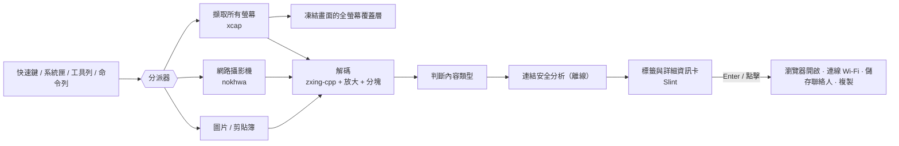

# QRcode tool


 · [English](../../README.md) · **繁體中文** · [简体中文](README.zh-CN.md) · [Español](README.es.md) · [Português (Brasil)](README.pt-BR.md) · [日本語](README.ja.md) · [한국어](README.ko.md) · [Français](README.fr.md) · [Deutsch](README.de.md) · [Русский](README.ru.md) · 

按一個快速鍵 → 螢幕上每個 QR Code 都會出現標籤 → 按 Enter 開啟。  

也能用網路攝影機掃描。免費、開源、不蒐集任何資料。

📘 **使用說明書：**[PDF](../manual/QRcode-tool-User-Manual-zh-TW.pdf) · [Word](../manual/QRcode-tool-User-Manual-zh-TW.docx)。每個[版本發布](https://github.com/naritaroad/qrcode-tool/releases/latest)也都附有說明書可下載。


---


## 功能與特色


|                     |                                                                                |
| ------------------- | ------------------------------------------------------------------------------ |
| ⚡ **使用便捷**          | 按 「Ctrl+Alt+Q 」或點系統匣圖示，凍結畫面並以快速掃描動畫自動找出所有條碼。                                   |
| 🏷️ **連結標籤**        | 每個條碼上會顯示真正的網站名稱。Enter 開啟、Tab 切換下一個、C 複製。                                       |
| ✂️ **框選區域**         | 條碼太小、模糊或歪斜時，像剪取工具一樣拖曳框選即可。                                                     |
| 📷 **視訊攝影機**        | 把紙本條碼或手機畫面對準鏡頭，結果即時顯示。                                                         |
| 🛡️ **連結安全檢查**      | 絕不會突然開啟連結。會提醒相似字母、偽裝網址（`bank.com@evil.io`）、IP 位址、未加密 `http`、短網址等，全部離線完成。       |
| 📶 **看懂內容**         | Wi-Fi（一鍵連線）、聯絡人（存成 vCard）、Email、電話、簡訊、地點、兩步驟驗證金鑰、台灣電子發票（左右兩碼自動合併）與一般文字。        |
| 🧾 **支援一維條碼**       | EAN、UPC、Code 128、Data Matrix、PDF417、Aztec…                                     |
| 🖼️ **圖片與剪貼簿**      | 掃描複製的截圖或任何圖片檔。                                                                 |
| 🔳 **簡易QR Code產生器** | 把連結或文字變成 QR Code，可複製或存成 PNG/SVG。                                               |
| 🧰 **簡潔工具列與收泡泡圖示**  | 簡潔的浮動工具列，可橫放於螢幕上方或直立於螢幕右側、左側，也能收合成泡泡圖示，全螢幕應用程式執行時自動隱藏。                                              |
| 🎨 **原生外觀**         | Windows系統風格，跟隨淺色/深色模式與系統輔色。                                                    |
| 🌍 **10 種語言**       | English、繁體中文、简体中文、Español、Português (Brasil)、日本語、한국어、Français、Deutsch、Русский。 |
| 🔒 **隱私保障**         | 全部用戶本機運行。不需帳號、沒有遙測、不會上網查詢連結。掃描記錄預設關閉。                                          |
| ☁️ **輕巧便節**         | 原生 Rust 核心，更高效能與更低的記憶體占用。                                                      |


## 使用介面展示


|                                                           |                                                                   |
| --------------------------------------------------------- | ----------------------------------------------------------------- |
|  可疑連結會說明原因，等你確認。 |  Wi-Fi 條碼一鍵連線，密碼預設隱藏。 |
|  掃描剪貼簿或圖片檔。           |  產生 QR Code。        |


## 架構




詳細設計請見 **[docs/ARCHITECTURE.md](../ARCHITECTURE.md)**（英文）。

**技術細節**（點擊展開）

#### 解碼策略

- 以 [zxing-cpp](https://github.com/zxing-cpp/zxing-cpp) 平行解碼每個螢幕的凍結截圖。
- 小螢幕另外以 2 倍放大再讀一次；大螢幕切成互相重疊的 900 px 區塊，4K 螢幕上的小條碼也找得到。
- 框選區域會加上留白並放大 2–3 倍。
- 網路攝影機在獨立執行緒解碼最新畫面，同一個條碼要連續 3 個畫面都讀到才算數。


#### DPI 與多螢幕

- 先擷取畫面再顯示覆蓋層；所有座標都以截圖像素表示，由介面自行縮放，混合 DPI 的多螢幕也不會錯位。


#### 連結安全規則

- 只有 `http`/`https` 可以開啟，其他協定只能複製。
- 不經過 shell，透過系統瀏覽器 API 開啟。
- 只有「唯一一個條碼、沒有任何警告、網站在信任清單內」時才會自動開啟。
- 不會上網展開短網址（那會讓短網址服務知道你掃了什麼）。


#### 敏感資料

- 兩步驟驗證金鑰與 Wi-Fi 密碼不會寫入記錄，也不會自動複製。
- 日誌只記錄事件與錯誤，不含掃描內容。


## 安裝


### Windows 10（21H2 以上）/ 11 — x64 與 ARM64

1. 到[最新版本](https://github.com/naritaroad/qrcode-tool/releases/latest)下載 `QRcodeTool-win-x64-Setup.exe`（ARM 電腦選 `…-arm64-…`）。
2. 執行即可，安裝在你的使用者帳號下（不需系統管理員權限），完成後在系統匣待命。
3. 按 Ctrl+Alt+Q 開始掃描（若已被其他程式占用，可在「設定 › 快捷鍵」改成別組）。在桌面空白處或圖片上按右鍵也能用（「設定 › 一般 › 右鍵清單」）。Windows 11 請先點「顯示更多選項」。

> **出現「Windows 已保護您的電腦」？** 早期版本尚未進行程式碼簽章，SmartScreen 可能顯示未知發行者。請點 **其他資訊 → 仍要執行**。每個版本都附 SHA-256 檢查碼可供核對，詳見 [FAQ](../FAQ.md#windows-smartscreen)。

也提供免安裝的**可攜版** `.zip`（不會自動更新）。版本發布中同時附有中、英文使用說明書（PDF 與 Word）。

### macOS 13 以上

從[最新版本](https://github.com/naritaroad/qrcode-tool/releases/latest)下載 `.pkg`。第一次掃描時，請在「系統設定 › 隱私權與安全性」允許**螢幕錄製**（使用攝影機時另需允許**相機**）。目前尚未公證，第一次請按右鍵 → **打開**。

### Linux

下載 `.AppImage`，加上執行權限後執行。使用 Wayland 時，請在桌面設定新增快速鍵執行 `qrcode-tool scan-screen`。

### 從原始碼建置

```bash
git clone https://github.com/naritaroad/qrcode-tool
cd qrcode-tool
cargo run --release
```

需要 Rust 1.85 以上、CMake 與 C++ 編譯器（建置 zxing-cpp 用）。各平台細節請見 **[docs/BUILDING.md](../BUILDING.md)**。

### 命令列

```text
qrcode-tool                     啟動（已在執行時會顯示工具列）
qrcode-tool scan-screen         掃描螢幕
qrcode-tool scan-region         凍結畫面後框選掃描
qrcode-tool scan-camera         用網路攝影機掃描
qrcode-tool scan-clipboard      掃描剪貼簿中的圖片
qrcode-tool scan-file 檔案      掃描一張圖片
qrcode-tool show-toolbar        顯示工具列
qrcode-tool generate "文字"     產生 QR Code
qrcode-tool decode 檔案… [--json]   不開介面直接解碼圖片
```


## 專案結構

```text
qrcode-tool/
├─ app/                    # 桌面應用程式（Slint 介面與整合）
│  ├─ src/                 #   系統匣、快速鍵、覆蓋層、預覽、設定、更新…
│  ├─ ui/                  #   .slint 視窗、元件、圖示
│  └─ translations/        #   9 種語言的 .po 翻譯檔
├─ crates/
│  ├─ qrtool-core/         # 內容解析、連結安全、設定、記錄（純 Rust）
│  ├─ qrtool-decode/       # zxing-cpp 解碼策略與 QR Code 產生
│  ├─ qrtool-capture/      # 多螢幕截圖（xcap）
│  ├─ qrtool-camera/       # 網路攝影機與即時解碼（nokhwa）
│  └─ qrtool-platform/     # 系統整合：開啟、開機啟動、主題、Wi-Fi、IPC、剪貼簿、右鍵清單
├─ assets/icons/           # 應用程式與系統匣圖示
├─ packaging/              # MSIX、Linux 桌面項目、macOS 套件資訊
├─ docs/                   # 架構、建置、FAQ、隱私、翻譯
│  └─ manual/              #   使用說明書（PDF 與 Word，10 種語言）及建置腳本
└─ .github/workflows/      # CI 與發佈流程
```


## 參與貢獻

歡迎回報問題、改善翻譯、貢獻程式碼與想法。

- 請先閱讀 **[CONTRIBUTING.md](../../CONTRIBUTING.md)**。
- 改善翻譯：**[docs/TRANSLATING.md](../TRANSLATING.md)**（目前譯文為機器翻譯後校對，非常歡迎母語者協助）。
- 發現安全問題請依 **[SECURITY.md](../../SECURITY.md)** 私下回報，不要開公開 issue。
- 參與者請遵守 **[行為準則](../../CODE_OF_CONDUCT.md)**。

如果 QRcode tool 幫你省下時間，歡迎[贊助這個專案](https://github.com/sponsors/naritaroad)。❤️

## 授權

本專案採用以下任一授權Q：

- Apache License, Version 2.0（[LICENSE-APACHE](../../LICENSE-APACHE)）
- MIT license（[LICENSE-MIT](../../LICENSE-MIT)）

除非你另有明確聲明，你提交的貢獻都將以上述雙授權釋出，不附加其他條款。

第三方元件與授權列於 [THIRD_PARTY_NOTICES.md](../../THIRD_PARTY_NOTICES.md)。介面以 [Slint](https://slint.dev) 建構，採用 Slint Royalty-free Desktop License。

### 相關專案

QRcode tool 受到以下專案啟發（未複製其程式碼），感謝它們示範了桌面 QR Code 掃描的可能性：

- [qrpeek](https://github.com/dzoffice/qrpeek) — 螢幕 QR Code 辨識工具
- [ScreenQRScanner](https://github.com/Konyaco/ScreenQRScanner) — 螢幕 QR Code 掃描器
- [QR-Code-Reader](https://github.com/ottozumkeller/QR-Code-Reader) — 結合剪取工具與 ZXing.Net 的讀取器
- [NormCap](https://github.com/dynobo/normcap) — 以 OCR 為核心的螢幕擷取工具
- [ShareX](https://github.com/ShareX/ShareX) — 含 QR Code 工具的螢幕擷取套件
- [CodeTwo QR Code Desktop Reader](https://www.codetwo.com/freeware/qr-code-desktop-reader/) — 免費桌面讀取器

---

QR Code 是 DENSO WAVE INCORPORATED 的註冊商標。QRcode tool 與 DENSO WAVE、Google、Microsoft 皆無關聯。